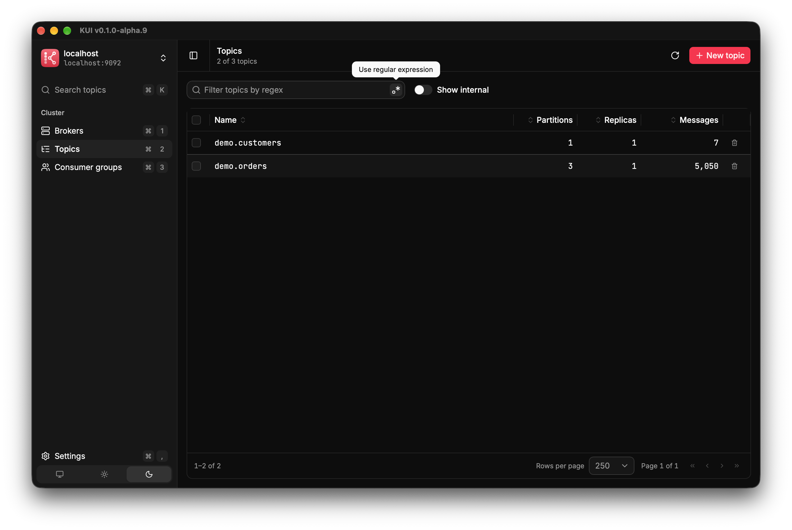
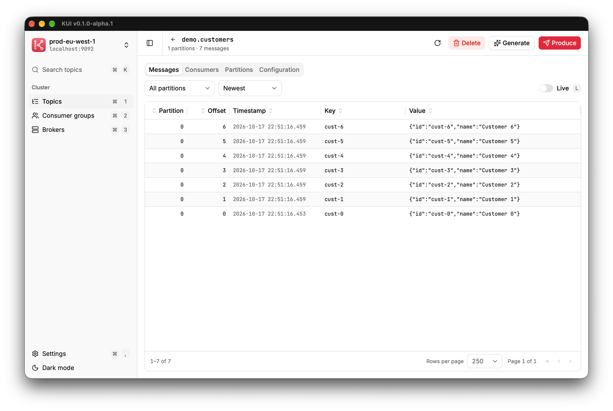
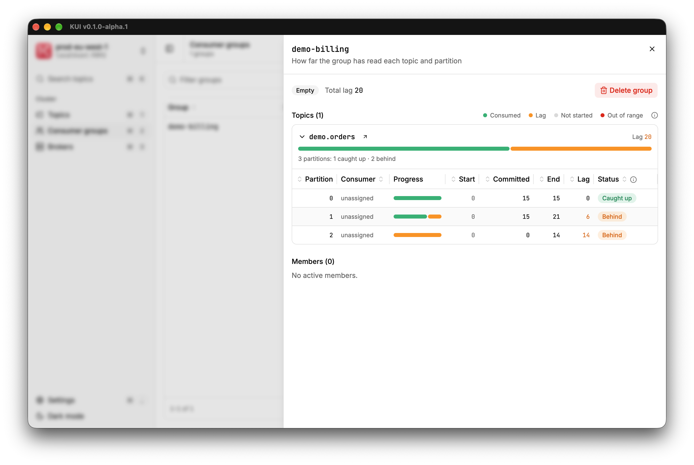
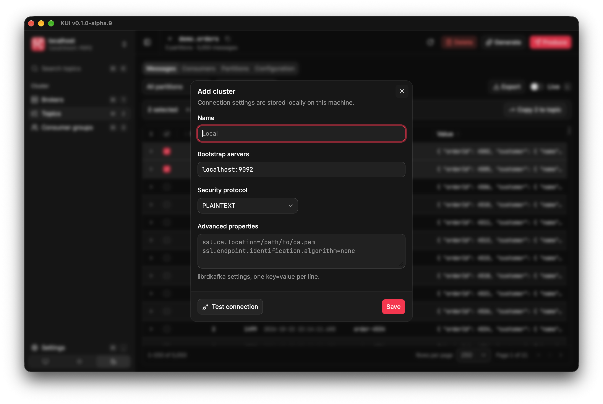
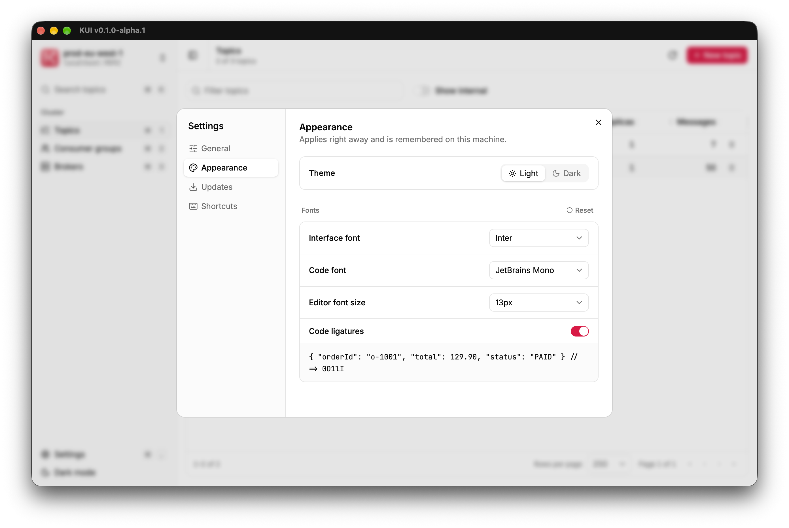

<p align="center">
  
</p>

<h1 align="center">KUI</h1>

<p align="center">
  <strong>A simple desktop app for Apache Kafka.</strong><br />
  See your topics, read and send messages, and check how far behind your consumers are.
</p>

<p align="center">

[](https://github.com/tructn/kui/actions/workflows/security.yml)
[](https://github.com/tructn/kui/actions/workflows/release.yml)

</p>

<p align="center">
  <a href="https://github.com/tructn/kui/releases/latest"><strong>Download for macOS &amp; Windows</strong></a>
</p>

<p align="center">
  
</p>

## What it does

- **Topics:** list, search (<kbd>⌘</kbd> <kbd>K</kbd>), create and delete them.
- **Messages:** read the newest or oldest messages, or watch new ones arrive live. Send your own, or generate test
  data.
- **Consumers:** see which consumer groups are caught up and which are behind.
- **Clusters:** add one with its address, test the connection, and save it. Secure clusters (SSL and SASL) work too.
- **Private:** your connection settings stay on your computer.

<table>
  <tr>
    <td width="50%" align="center">
      <br />
      <sub>Read messages</sub>
    </td>
    <td width="50%" align="center">
      <br />
      <sub>See consumer progress</sub>
    </td>
  </tr>
  <tr>
    <td width="50%" align="center">
      <br />
      <sub>Add a cluster</sub>
    </td>
    <td width="50%" align="center">
      <br />
      <sub>Light or dark mode, your fonts</sub>
    </td>
  </tr>
</table>

## Install

Download the installer from the [latest release](https://github.com/tructn/kui/releases/latest):

| Computer | File |
| --- | --- |
| Mac with Apple silicon (M1 or newer) | `KUI_<version>_aarch64.dmg` |
| Windows 10 or 11 | `KUI_<version>_x64-setup.exe` |

KUI isn't signed with a paid Apple or Microsoft certificate yet, so both systems warn you the first time you open
it. That's expected; you only need to allow it once.

**macOS**

1. Open the `.dmg` and drag KUI into **Applications**.
2. Open KUI. When macOS says it can't verify the app, click **Done**.
3. Go to **System Settings → Privacy & Security**, scroll down, and click **Open Anyway** next to "KUI" was blocked.

   Or run this in Terminal instead, then open KUI again:

   ```bash
   xattr -dr com.apple.quarantine /Applications/KUI.app
   ```

**Windows**

1. Run the installer.
2. If you see "Windows protected your PC", click **More info**, then **Run anyway**.

KUI updates itself: it checks for new versions when it starts and asks before installing them.

## Contributing

Bug reports and ideas are welcome in [Issues](https://github.com/tructn/kui/issues). To build KUI yourself, see
[CONTRIBUTING.md](CONTRIBUTING.md).

## License

[MIT](./LICENSE) © 2026 Truc Nguyen
