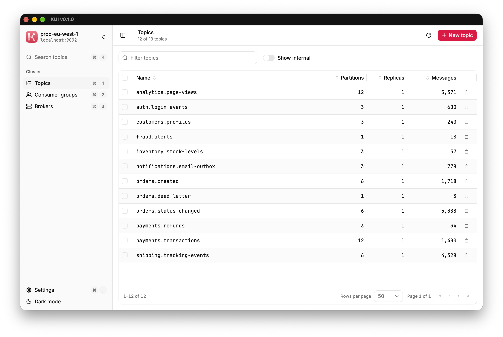
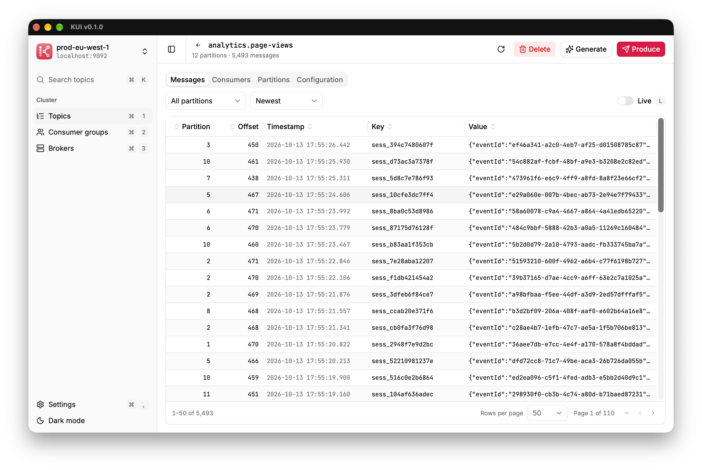
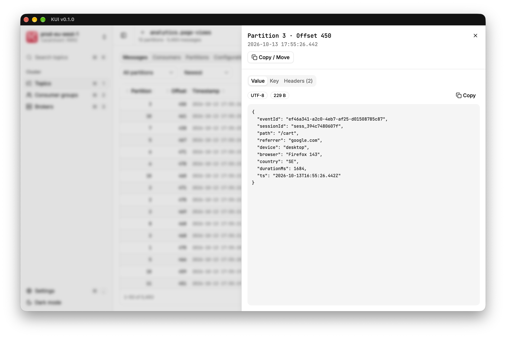
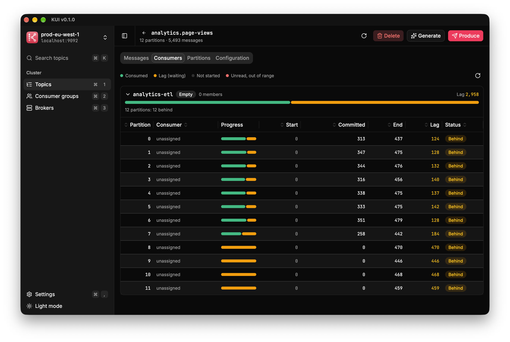
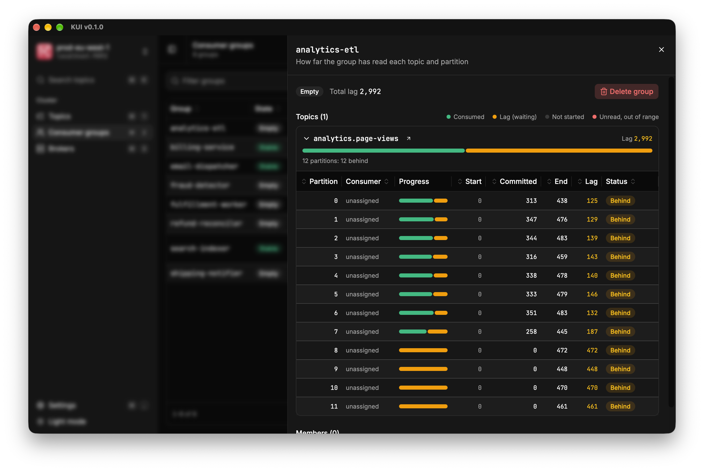
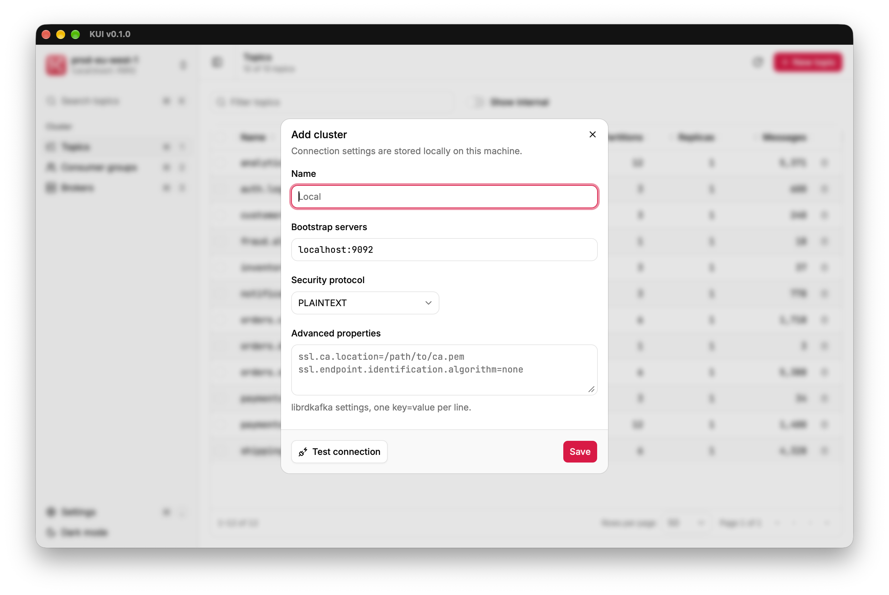

  

<h1 align="center">KUI</h1>

  <strong>A fast, friendly desktop app for Apache Kafka.</strong> 
  Browse topics, read and produce messages, and see consumer lag at a glance, without a single CLI flag.

  <a href="https://github.com/tructn/kui/releases/latest"><strong>Download for macOS &amp; Windows</strong></a>

  

## Why KUI

The Kafka CLI can do almost anything, as long as you remember the flags. Web consoles are friendlier, but someone has
to deploy and run them first. KUI is a desktop app instead: open it, add your cluster, and every topic, message and
consumer group is a click or a keystroke away.

- **Small and fast.** Built in Rust with [Tauri](https://tauri.app), using your system's built-in webview instead of
  bundling a browser. Quick startup, no JVM, no Docker, no server to run.
- **Your data stays local.** Connection settings live on your machine. Nothing is sent anywhere else.
- **Built for daily use.** Keyboard shortcuts everywhere, a topic search on <kbd>⌘</kbd> <kbd>K</kbd>, and light and
  dark themes.

## Read messages the way you think about them

Jump to the newest or oldest messages, a specific offset, or a point in time, in any partition. Flip on **Live**
and new messages stream in as they arrive.

  

Open any message to see its value as pretty-printed JSON, plus its key and headers. Then **copy, duplicate or move**
it to another topic, byte for byte, headers included.

  

## See consumer lag at a glance

Every consumer group shows how far it has read each partition, with progress bars, lag per partition and a clear
status. Spot the stuck consumer in seconds.

  

  

## Connect to any cluster

PLAINTEXT, SSL and SASL (PLAIN, SCRAM) work out of the box, and any librdkafka property can be added for the
unusual setups. Test the connection before you save it, and switch between clusters from the sidebar.

  

## And more

- Create and delete topics; inspect partitions, watermarks, replicas and configuration
- Consumer group members and assignments; delete groups
- Broker overview with under-replicated and offline partition counts
- Sortable, resizable columns and fast filtering across every table

## Install

Grab the latest installer from the [Releases](https://github.com/tructn/kui/releases/latest) page.

| Platform | Download |
| --- | --- |
| macOS (Apple Silicon) | `KUI_<version>_aarch64.dmg` |
| Windows 10/11 (x64) | `KUI_<version>_x64-setup.exe` |

**macOS:** open the `.dmg` and drag KUI into Applications. The first time, right-click KUI and choose
**Open** (builds aren't notarized yet). If macOS says the app is damaged, run
`xattr -dr com.apple.quarantine /Applications/KUI.app`.

**Windows:** run the installer. No admin rights are needed. If SmartScreen appears, click **More info** →
**Run anyway**.

## Contributing

Bug reports and ideas are welcome in [Issues](https://github.com/tructn/kui/issues). To build KUI yourself, see
[CONTRIBUTING.md](CONTRIBUTING.md).

## License

[MIT](./LICENSE) © 2026 Truc Nguyen
