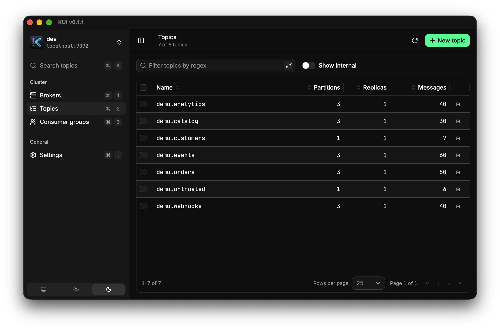
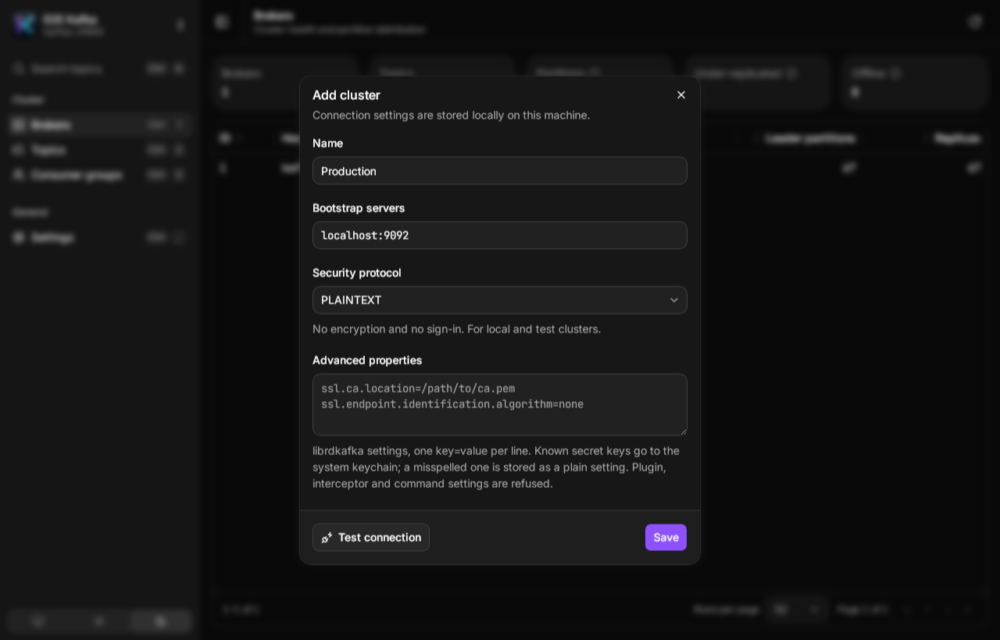
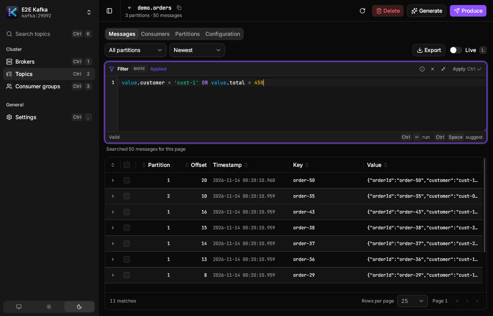
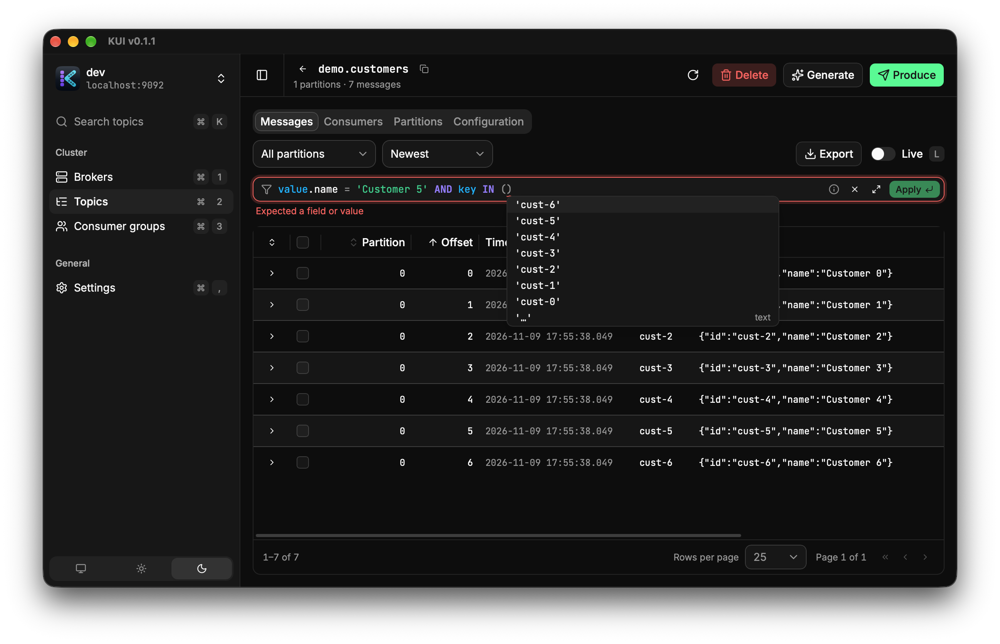
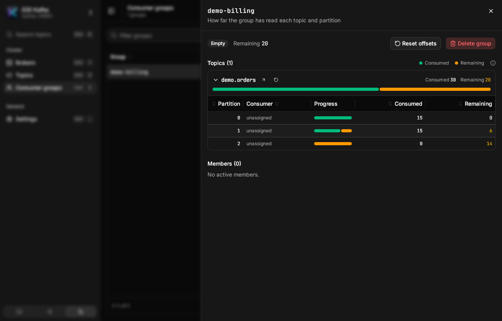
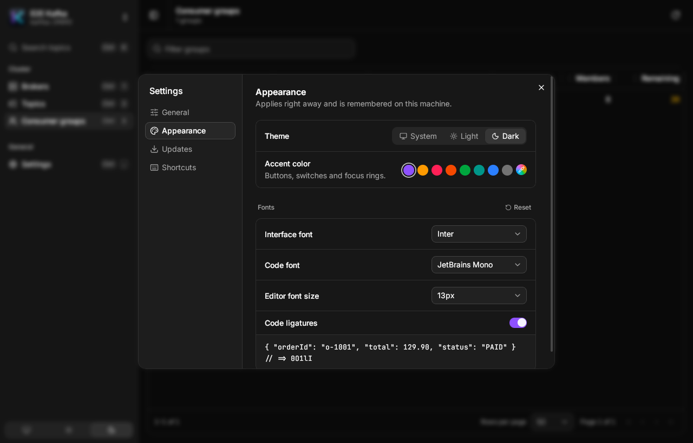

<p align="center">
  
</p>

<h1 align="center">KUI</h1>

<p align="center">
  <strong>Kafka, without the terminal.</strong><br />
  A fast, free desktop app to browse topics, read and send messages, and keep an eye on your consumers.
</p>

<p align="center">
  <a href="https://github.com/tructn/kui/actions/workflows/release.yml"></a>
  <a href="https://github.com/tructn/kui/actions/workflows/ci.yml"></a>
  <a href="https://github.com/tructn/kui/actions/workflows/security.yml"></a>
  <a href="LICENSE"></a>
</p>

<p align="center">
  <a href="https://github.com/tructn/kui/releases/latest"><strong>⬇&nbsp; Download for macOS &amp; Windows</strong></a>
  &nbsp;·&nbsp;
  <a href="#features">Features</a>
  &nbsp;·&nbsp;
  <a href="#install">Install</a>
</p>

<p align="center">
  
</p>

## Why KUI

Most Kafka tools are either command-line scripts or web dashboards you have to deploy and keep running.
KUI is neither. It's a desktop app: download it, add your cluster, and you're looking at your data.

- **Nothing to set up.** No server, no Docker, no config files. Install it like any other app.
- **Small and fast.** Built with [Tauri](https://tauri.app) and Rust, so it starts quickly and uses little memory.
- **Private by design.** Your clusters and passwords stay on your computer, with passwords in the system keychain. KUI doesn't collect anything.
- **Free and open source.** MIT licensed, with no account and no paid tier.

## Features

### Connect to any cluster



Add a cluster, test the connection and save it. TLS, mutual TLS and SASL (PLAIN, SCRAM, OAuth) are supported.

### Find any topic in seconds

Search topics with <kbd>⌘</kbd> <kbd>K</kbd>, see partitions and message counts at a glance, and create or
delete topics.

### Read and filter messages





Browse from the newest or oldest message, or watch new ones arrive live. Filter with SQL-like queries such as
`value.status = 'shipped'`, with suggestions as you type (see the [query guide](crates/kui_mql/README.md)).
Export to JSON or CSV, or copy messages to another topic.

### Send messages and generate test data

Send a message with its own key and headers, or fill a topic with generated test data.

### Know which consumers are falling behind



See how far behind each consumer group is, and reset its offsets when it needs a fresh start.

### Make it yours



Light or dark theme, your own fonts, and automatic update checks.

## Install

Download the installer from the [latest release](https://github.com/tructn/kui/releases/latest):

| Computer | File |
| --- | --- |
| Mac with Apple silicon (M1 or newer) | `KUI_<version>_aarch64.dmg` |
| Mac with an Intel processor | `KUI_<version>_x64.dmg` |
| Windows 10 or 11 | `KUI_<version>_x64-setup.exe` |

Not sure which Mac you have? Open the Apple menu → **About This Mac**: it lists a **Chip** (Apple M1 or newer)
on Apple silicon and a **Processor** (Intel) on an Intel Mac.

KUI isn't signed with a paid Apple or Microsoft certificate yet, so both systems warn you the first time you open
it. That's expected; you only need to allow it once.

<details>
<summary><strong>macOS</strong></summary>

1. Open the `.dmg` and drag KUI into **Applications**.
2. Open KUI. When macOS says it can't verify the app, click **Done**.
3. Go to **System Settings → Privacy & Security**, scroll down, and click **Open Anyway** next to "KUI" was blocked.
   On macOS 11 and 12 it's **System Preferences → Security & Privacy → General**.

   Or run this in Terminal instead, then open KUI again:

   ```bash
   xattr -dr com.apple.quarantine /Applications/KUI.app
   ```

</details>

<details>
<summary><strong>Windows</strong></summary>

1. Run the installer.
2. If you see "Windows protected your PC", click **More info**, then **Run anyway**.

</details>

## Contributing

Bug reports and ideas are welcome in [Issues](https://github.com/tructn/kui/issues). If KUI saves you time,
a ⭐ on GitHub helps other people find it.

To build KUI yourself, see [CONTRIBUTING.md](CONTRIBUTING.md).

## License

[MIT](./LICENSE) © 2026 Truc Nguyen
