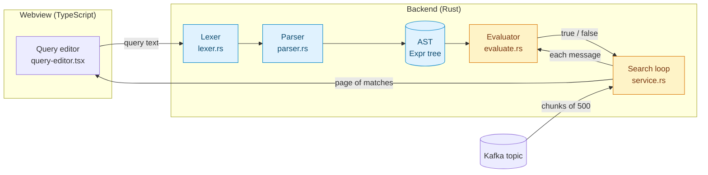
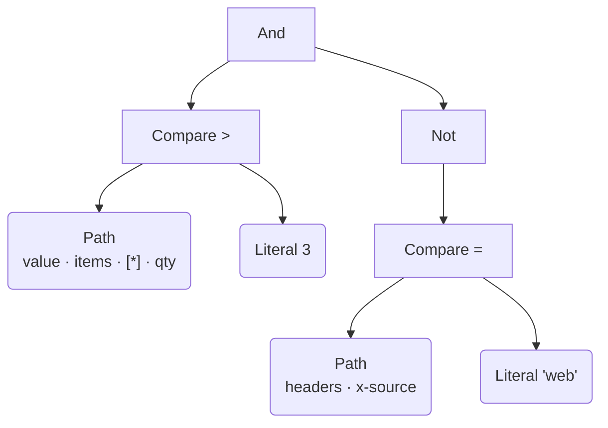
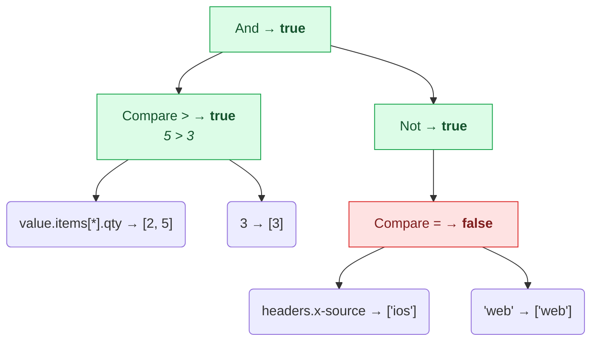
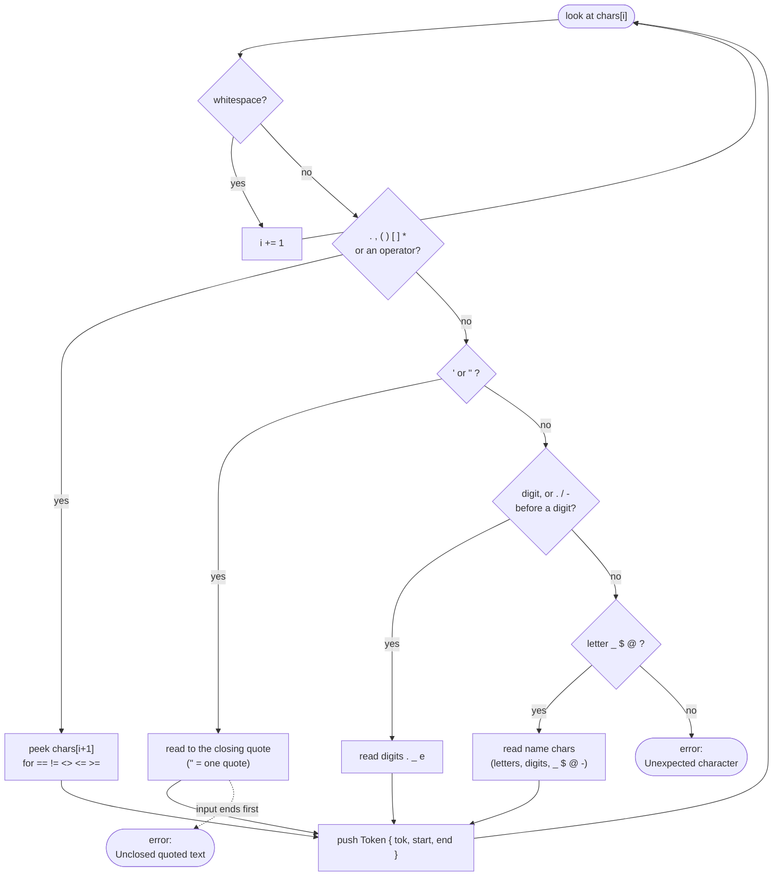
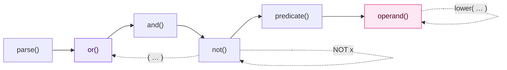
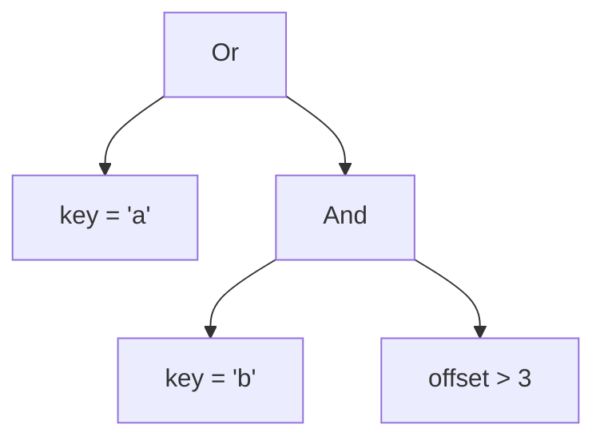
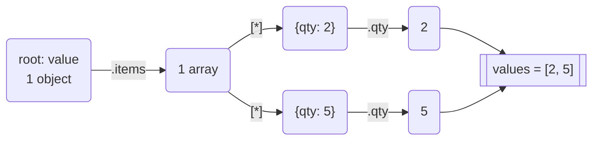
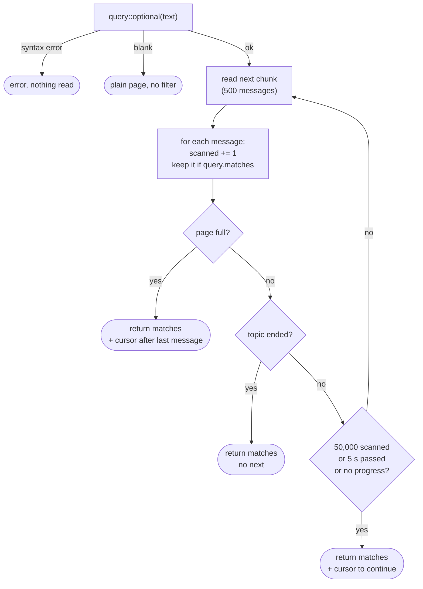
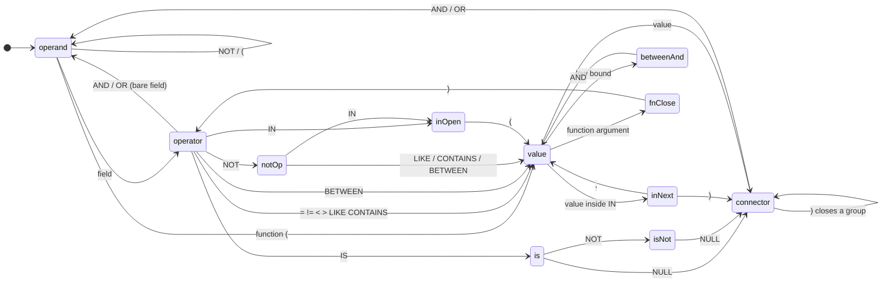
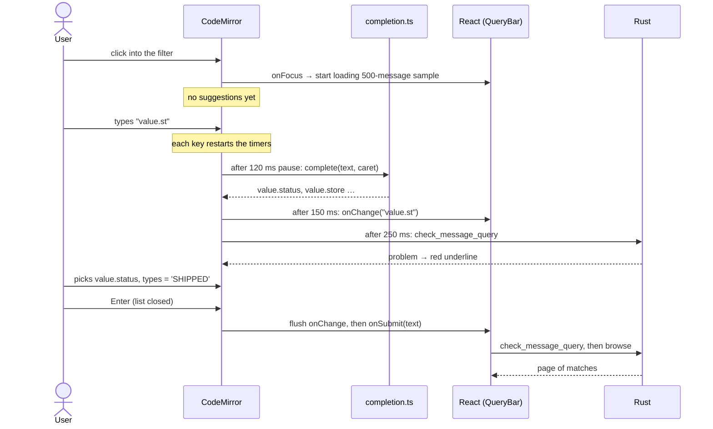

# kui_tql

The interpreter for **TQL**, the *topic query language*: the SQL-like filter KUI uses to search a Kafka topic's
messages. A query is the part of SQL that would follow `WHERE`:

```sql
value.status = 'shipped' AND value.items[*].qty > 3
```

In the app, you type it in the filter bar above the message table and press **Enter** (or **Apply**). The
filter applies to browsing, to the **live tail**, and to **exports** of a range, so an export saves only the
matching messages.

## At a glance

The crate parses a query once, then tests it against each message. It has no Kafka or Tauri dependencies:
messages come in through the `Record` trait, which KUI implements for its `Message` type in
`crates/kui_desktop/src/features/messages/query.rs`.

```rust
use kui_tql::Query;

let query = Query::parse("value.status = 'shipped' AND headers.source = 'web'")?; // Err(QueryError) on a typo
if query.matches(&message) {                                                     // any `impl Record`
    // keep it
}
```

| Item | What it is |
| ---- | ---------- |
| `Query::parse(&str)` | Lexes and parses a query; `QueryError { message, start, end }` points at the problem (UTF-16 offsets) |
| `Query::matches(&impl Record)` | Runs the parsed query against one message |
| `Record` | What a message must provide: `partition`, `offset`, `timestamp`, `key`, `value`, `headers` |
| `Payload { text, utf8 }` | A key or value as displayed; only `utf8` text is tried as JSON |

```sh
cargo test -p kui_tql   # all lexer, parser and evaluator tests, in seconds
```

File paths in this guide are relative to the repository root.

This guide covers the language from three angles. Pick the part that fits you:

| Part | For | What's in it |
| ---- | --- | ------------ |
| [I. Using the language](#part-i-using-the-language) | everyone | syntax, operators, how messages of different shapes are handled |
| [II. Walkthrough for newcomers](#part-ii-walkthrough-for-newcomers) | anyone new to language implementation or to this code | how text becomes a result, stage by stage, with diagrams, traces and exercises. **No compiler or interpreter experience assumed.** |
| [III. Reference for contributors](#part-iii-reference-for-contributors) | people changing the code | precise grammar, evaluation rules, the search loop, API, completion details, tests, extension checklist |

New to this code? Read Part I quickly, then Part II sections 1–4 in order. They give you the map and the
vocabulary. Everything after that can be read on its own, next to the source file it describes.

## Contents

- [At a glance](#at-a-glance)
- [Part I: Using the language](#part-i-using-the-language)
  - [Fields](#fields) · [Operators](#operators) · [Values](#values) · [Functions](#functions) ·
    [Messages of different shapes](#messages-of-different-shapes) · [Comparing by meaning](#comparing-by-meaning) ·
    [Dates](#dates) · [Examples](#examples) · [Suggestions](#suggestions) · [Searching large topics](#searching-large-topics)
- [Part II: Walkthrough for newcomers](#part-ii-walkthrough-for-newcomers)
  1. [What problem are we solving?](#1-what-problem-are-we-solving)
  2. [The big picture: four stages](#2-the-big-picture-four-stages)
  3. [Vocabulary](#3-vocabulary)
  4. [One query, start to finish](#4-one-query-start-to-finish)
  5. [Stage 1: the lexer (`lexer.rs`)](#5-stage-1-the-lexer-lexerrs)
  6. [Stage 2: the parser (`parser.rs`)](#6-stage-2-the-parser-parserrs)
  7. [Stage 3: the evaluator (`evaluate.rs`)](#7-stage-3-the-evaluator-evaluaters)
  8. [Stage 4: searching a topic (`service.rs`)](#8-stage-4-searching-a-topic-servicers)
  9. [The editor side (TypeScript)](#9-the-editor-side-typescript)
  10. [Rust features you'll meet in this code](#10-rust-features-youll-meet-in-this-code)
  11. [Exercises: extending the language](#11-exercises-extending-the-language)
  12. [Testing and debugging](#12-testing-and-debugging)
  13. [FAQ and pitfalls](#13-faq-and-pitfalls)
- [Part III: Reference for contributors](#part-iii-reference-for-contributors)
  - [Grammar and AST](#grammar-and-ast-parserrs) · [Evaluation](#evaluation-evaluaters) ·
    [Searching](#searching-servicers) · [API changes](#api-changes) · [Suggestions](#suggestions-typescript) ·
    [Tests](#tests) · [Extending the language](#extending-the-language)

---

## Part I: Using the language


### Fields

Every condition starts from one of six message attributes:

| Field       | What it is                                                                      |
| ----------- | ------------------------------------------------------------------------------- |
| `key`       | The key: parsed JSON when it is JSON, otherwise its text                        |
| `value`     | The value (payload), the same way                                               |
| `headers`   | The headers; `headers.<name>` is one header's value                             |
| `partition` | Partition number                                                                |
| `offset`    | Offset within the partition                                                     |
| `timestamp` | Message time, in epoch milliseconds (compare it with a date, see [Dates](#dates)) |

Go inside JSON with paths:

| Path                        | Meaning                                                                    |
| --------------------------- | -------------------------------------------------------------------------- |
| `value.customer.name`       | Object fields                                                              |
| `value."first name"`        | A name with spaces, dots or other symbols, in double quotes (`""` = one `"`) |
| `value['first name']`       | The same, bracket style                                                    |
| `value.items[0]`            | An array element; `[-1]` is the last one                                   |
| `value.items[*].sku`        | **Every** element (the condition passes if any one of them matches)        |
| `value.items.sku`           | Same as `[*]`: a name applied to an array looks inside each element        |
| `headers.x-trace-id`        | Header names may contain `-`. Names are matched exactly, then ignoring case |
| `value.meta.source`         | Also works when `meta` is a **string** holding JSON (`"{\"source\":\"web\"}"`), at any depth |

### Operators

| Operator                        | Example                                    | Notes                                                    |
| ------------------------------- | ------------------------------------------ | -------------------------------------------------------- |
| `=` `!=` `<>`                   | `value.status = 'shipped'`                 | `==` also works                                          |
| `<` `<=` `>` `>=`               | `value.total >= 100`                       | Numbers, text, or dates                                  |
| `LIKE`, `ILIKE`                 | `key LIKE 'order-%'`                       | `%` any text, `_` one character, `\` escapes. `ILIKE` ignores case |
| `CONTAINS`                      | `value CONTAINS 'timeout'`                 | Text inside text, or an element of an array (below)      |
| `IN ( … )`                      | `headers.x-source IN ('web', 'ios')`       | Any of a list                                            |
| `BETWEEN … AND …`               | `offset BETWEEN 100 AND 200`               | Both ends included                                       |
| `IS NULL`, `IS NOT NULL`        | `value.error IS NOT NULL`                  | `NULL` = missing **or** JSON `null`. `= null` means the same |
| `NOT` before `LIKE`, `ILIKE`, `CONTAINS`, `IN`, `BETWEEN` | `value.tags NOT CONTAINS 'test'` |                                    |
| `AND`, `OR`, `NOT`, `( … )`     | `NOT (a OR b) AND c`                       | `NOT` binds tightest, then `AND`, then `OR`              |
| A field on its own              | `value.paid AND NOT value.deleted`         | True when present and not `null`, `false`, `0` or `''`   |

`CONTAINS` depends on what it's given:

- **Text:** a substring match (case-sensitive; use `lower(…)` to ignore case).
- **An array:** whether one element equals the value, so `value.tags CONTAINS 'vip'` matches `["vip", "eu"]` but `'vi'` doesn't.
- **A whole `key` or `value`:** searches the payload text **as it was sent**, so `value CONTAINS '"status": "failed"'` works when the JSON has that spacing.

Keywords are case-insensitive (`and` = `AND`). Field names are case-sensitive, except header names. An optional
leading `WHERE` is allowed.

### Values

| Kind      | Written as                                        |
| --------- | ------------------------------------------------- |
| Text      | `'single quotes'`; write `''` for a `'` inside     |
| Numbers   | `42`, `-1.5`, `2.5e3`, `1_000_000`                 |
| Booleans  | `true`, `false`                                    |
| Null      | `NULL`                                             |

### Functions

| Function       | Gives                                                                         |
| -------------- | ----------------------------------------------------------------------------- |
| `lower(x)`     | Text in lowercase: `lower(value.email) LIKE '%@example.com'`                  |
| `upper(x)`     | Text in uppercase                                                             |
| `trim(x)`      | Text without spaces at either end                                             |
| `length(x)`    | Characters of text, items of an array, or keys of an object: `length(value.items) > 10` |
| `type(x)`      | `'string'`, `'number'`, `'boolean'`, `'object'`, `'array'` or `'null'`        |

`type()` is handy when a field's type differs between messages: `type(value.id) = 'string'`.

### Messages of different shapes

A topic often carries several kinds of messages (event types, schema versions), so a field one message has may
be missing in another. The filter treats that as normal, not as an error:

- **A missing field matches nothing.** `value.status = 'x'`, `value.total > 3` and `value.name LIKE 'a%'` are all
  false for a message without that field.
- **Negations match it.** `!=`, `NOT LIKE`, `NOT IN`, `NOT CONTAINS`, `NOT BETWEEN` and `IS NULL` are true for
  a missing field. So `value.type != 'order'` means *everything except orders*, including messages with no `type`.
  (This differs from SQL, where comparing with a missing value is always unknown.)
- **Paths that reach many values** (`[*]`, or a name across an array) pass if **any** value passes.
  `value.items[*].qty > 3` means *some item has qty above 3*. Its negation, `NOT value.items[*].qty > 3`, means
  *no item does*.
- **Payloads that aren't JSON** are one text value: `value LIKE 'ERROR%'` works on plain log lines. Binary
  payloads are compared as their hex text.

### Comparing by meaning

Values are compared by what they mean, not only by their JSON type:

| Comparison                         | Result                                    |
| ---------------------------------- | ----------------------------------------- |
| `value.id = '42'` with `"id": 42`  | Matches: text that is a number compares as a number |
| `headers.retries >= 3`             | Header values are text, and still compare as numbers |
| `value.paid = 'true'`              | Matches `"paid": true`                    |
| `value.total > 10` with `"total": "19.90"` | Matches                           |
| Two pieces of text                 | Compared alphabetically, case-sensitive   |
| Objects or arrays                  | Only `=` (equal as JSON)                  |
| Anything else (e.g. text vs object) | Never matches                            |

### Dates

A date in quotes compares with any number as epoch milliseconds. That works for `timestamp` and for payload
fields holding epoch-millis times:

```sql
timestamp >= '2026-10-01'                        -- midnight, local time
timestamp BETWEEN '2026-10-01 08:00' AND '2026-10-01 09:30:15.250'
value.createdAt > '2026-10-01T08:00:00Z'         -- RFC 3339: UTC or with an offset
```

Dates without a zone are **local time**, the same as the table shows.

### Examples

```sql
-- Orders that shipped to VIP customers
value.type = 'order' AND value.status = 'shipped' AND value.customer.tags CONTAINS 'vip'

-- Any line item over 100, for one customer, ignoring email case
value.items[*].price > 100 AND lower(value.customer.email) = 'ada@example.com'

-- Events from a schema version that has no `version` field yet
value.version IS NULL

-- Messages whose id was sent as text instead of a number
type(value.id) = 'string'

-- Retried messages from web or iOS in the last morning
headers.retries > 0 AND headers.x-source IN ('web', 'ios') AND timestamp >= '2026-10-31 06:00'

-- Plain-text logs
value ILIKE '%connection reset%' AND NOT value LIKE 'DEBUG%'
```

### Suggestions

Suggestions appear as you type (after a short pause), never just from clicking into the bar. **Ctrl+Space**
(or **⌘L** on macOS, where ⌘Space is Spotlight) opens them, **↑ / ↓** pick one, **Enter** accepts and **Esc** closes them.
They come from the topic itself: the first time the filter bar gets focus, KUI reads the newest 500 messages,
plus whatever the table and live tail show, and learns:

- **Every field path**, including fields only some messages have. Each suggestion shows the field's types and
  how many sampled messages have it, e.g. `string · 75%`. A field without a percentage is in every message.
- **Fields by name alone.** Type `email` to get `value.customer.email` without knowing where it sits.
- **Operators that fit the field.** Text gets `LIKE` / `CONTAINS`, numbers `BETWEEN` / `>`, arrays `CONTAINS`,
  booleans `= true`.
- **Values that actually occur**, most common first, with how often they appear. For `timestamp`, recent dates.
- **`AND` / `OR` / `)`** once a condition is complete.

Value suggestions are a summary, not every value in the sample. Each field shows at most its **30 most common
values**. Text longer than 120 characters isn't suggested. Fields with a different value in nearly every message,
like ids, only show the first values seen. So a `status` field with 4 values shows 4, even across 500 messages.
To find a value outside the list, type it, or use `LIKE '%…%'`.

Mistakes are underlined as you type, with the reason under the bar, and **Apply** stays disabled until the filter
is valid.

### Limits

A query may nest parentheses, `NOT` and function calls 64 levels deep and use at most 500 `AND` / `OR` / `NOT`
operators; beyond that it is a normal syntax error. Comparing two multi-valued paths (`value.a[*] = value.b[*]`)
tests every pair, so each message gets a budget of 1,000,000 comparisons. A message that exhausts it fails closed:
it does not match the query at all, however the condition is combined (`NOT`, `!=`, `AND`, `OR`).
`LIKE` and `ILIKE` draw on the same budget by text length times pattern length plus both lengths (a sixteenth of a
comparison per step, so `value LIKE '%error%'` on a multi-megabyte message is unaffected), and `CONTAINS`, a
linear search, by both lengths only. This includes patterns read from another field.

### Searching large topics

A filter doesn't make Kafka do the work: KUI reads messages and tests each one. One page of results stops reading
after **50,000 messages or 5 seconds**, whichever comes first, so the app stays responsive. The line under the
filter bar says how many messages that page read. If the page stopped early, it may have fewer matches than the
page size (or none). **Next page continues the search** from exactly where it stopped, without skipping or
repeating anything.

Pages of results have no overall count, so the footer shows the matches on the page and the page number.

To search faster, narrow the range first: pick a partition, or start **From time** / **From offset**.

---

## Part II: Walkthrough for newcomers

This part explains how the filter works, from the moment someone types `value.status = 'shipped'` to the
moment the table shows only shipped orders. Every idea is introduced before it is used, and each stage is
shown on a real query.

---

### 1. What problem are we solving?

A Kafka topic can hold millions of messages. Each message has:

| Part        | Example                                                        |
| ----------- | -------------------------------------------------------------- |
| `key`       | `order-17`                                                     |
| `value`     | `{"status": "SHIPPED", "items": [{"sku": "A-1", "qty": 5}]}`   |
| `headers`   | `x-source: web`, `x-trace-id: abc`                             |
| `partition` | `2`                                                            |
| `offset`    | `40`                                                           |
| `timestamp` | `1790812800000` (milliseconds since 1970)                      |

Users want to say *"show me only messages where …"*. We could have built a form with dropdowns, but message
shapes vary too much for that. Instead users type a small **language**, modeled on the `WHERE` part of SQL:

```sql
value.status = 'SHIPPED' AND value.items[*].qty > 3
```

The computer can't do anything useful with that line while it's just characters. It needs a structured
description it can check against each message. Turning text into that structure, and then using it, is the
job of the `kui_tql` crate in `crates/kui_tql/`. It knows nothing about Kafka: the app hands it
messages through the `Record` trait (implemented in `crates/kui_desktop/src/features/messages/query.rs`).

> **Key idea.** A query is a *program* in a tiny language. Our code reads the program once, then runs it once
> per message. That's all a "language implementation" is.

---

### 2. The big picture: four stages

```text
  "value.total > 10"                       text the user typed
          │
          ▼  Stage 1: LEXER      lexer.rs      split into words ("tokens")
  [value] [.] [total] [>] [10] [EOF]
          │
          ▼  Stage 2: PARSER     parser.rs     arrange the words into a tree
        Compare
       ╱   │   ╲
  Path    Gt    Literal
  value.total   10
          │
          ▼  Stage 3: EVALUATOR  evaluate.rs   run the tree against ONE message → true / false
  message #1 → true   message #2 → false   …
          │
          ▼  Stage 4: SEARCH     service.rs    read messages from Kafka, keep the "true" ones
  page of matching messages → UI
```

The same pipeline as a diagram, showing which side of the app each part runs on:



<sub>Blue runs **once per query**; amber runs **once per message**.</sub>

Stages 1 and 2 happen **once per query**. Stage 3 happens **once per message**, possibly millions of times,
which is why we parse up front instead of re-reading the text for every message.

There is also a **fifth, separate piece**: the TypeScript code in `frontend/features/messages/query/`. It runs in
the editor while the user types, for colors and suggestions. It never decides which messages match; Rust
always does. [Section 9](#9-the-editor-side-typescript) explains why it exists.

#### Where each piece lives

| File                                                     | Language | Job                                                                   |
| -------------------------------------------------------- | -------- | --------------------------------------------------------------------- |
| `crates/kui_tql/src/lib.rs`                      | Rust     | Public face: `Query::parse`, `Query::matches`, `Record`, `QueryError` |
| `crates/kui_tql/src/lexer.rs`                    | Rust     | Stage 1: text → tokens                                                |
| `crates/kui_tql/src/parser.rs`                   | Rust     | Stage 2: tokens → tree (`Expr`)                                       |
| `crates/kui_tql/src/evaluate.rs`                 | Rust     | Stage 3: tree + message → bool                                        |
| `crates/kui_desktop/src/features/messages/query.rs`                     | Rust     | `Record` for KUI's `Message`; `optional` (blank = no filter)          |
| `crates/kui_desktop/src/features/messages/service.rs`                   | Rust     | Stage 4: the search loop (`browse_with`), live tail                   |
| `crates/kui_desktop/src/features/messages/commands.rs`                  | Rust     | `check_message_query`: parse only, for error underlines               |
| `crates/kui_desktop/src/features/messages/window.rs`                    | Rust     | `resume_after`: the cursor after part of a page                       |
| `frontend/features/messages/query/lexer.ts`              | TS       | Forgiving tokenizer for colors and suggestions                        |
| `frontend/features/messages/query/catalog.ts`            | TS       | Learns which fields exist from sampled messages                       |
| `frontend/features/messages/query/completion.ts`         | TS       | Decides what to suggest at the caret                                  |
| `frontend/features/messages/query/use-field-catalog.ts`  | TS       | Builds the catalog lazily, only when suggestions ask                  |
| `frontend/features/messages/components/query-editor.tsx` | TS       | The CodeMirror editor that ties it together                           |
| `frontend/features/messages/components/query-bar.tsx`    | TS       | The bar around it: Apply, Clear, error line, syntax help              |

---

### 3. Vocabulary

Learn these words once and the rest of the code will read much more easily.

| Word | Meaning | In our code |
| ---- | ------- | ----------- |
| **Token** | One "word" of the language: a name, a number, a string, an operator. Like splitting a sentence into words and punctuation. | `Token { tok, start, end }` in `lexer.rs` |
| **Lexer** (tokenizer, scanner) | Code that turns characters into tokens. It knows `>=` is one token and that spaces don't matter. | `tokenize()` |
| **Grammar** | The rules for which token orders are allowed, e.g. "a comparison is an operand, an operator, an operand". | The comment at the top of `parser.rs` |
| **Parser** | Code that checks tokens against the grammar and builds a tree from them. | `parse()` and the `Parser` struct |
| **AST** (abstract syntax tree) | The tree the parser builds. "Abstract" because it drops details like spaces and parentheses. Only the meaning stays. | `enum Expr`, `enum Operand` |
| **Node** | One box in the tree, e.g. an `And` with two children. | Each `Expr::…` variant |
| **Recursive descent** | A way to write a parser by hand: one function per grammar rule, and functions call each other (sometimes themselves). | `or()`, `and()`, `not()`, `predicate()`, `operand()` |
| **Precedence** | Which operator "binds tighter". In `a OR b AND c`, `AND` binds tighter, so it means `a OR (b AND c)`. | The order in which `or → and → not` call each other |
| **Literal** | A value written directly in the query: `'web'`, `42`, `true`, `NULL`. | `enum Literal` |
| **Path** | A way to reach inside a message: `value.items[0].sku`. | `Operand::Path { root, segments }` |
| **Evaluate / interpret** | Run the tree against data to get an answer. | `evaluate()` |
| **Tree-walking interpreter** | An evaluator that visits tree nodes recursively. It's the simplest kind, and it's the kind we have. We never produce machine code. | `evaluate.rs` |
| **Lookahead** | Peeking at the next token(s) without consuming them, to decide what to do. | `Parser::peek()` |
| **EOF** | "End of file": a fake last token, so the parser always has something to peek at. | `Tok::Eof` |

> **"Compiler" or "interpreter"?** A compiler translates a program into another language (often machine code).
> An interpreter runs it directly. We do the front half of a compiler (lexing and parsing) and then interpret
> the tree, never producing any other code. So TQL is interpreted, not compiled.

---

### 4. One query, start to finish

Before diving into each file, let's follow a single query all the way through. Here is the query:

```sql
value.items[*].qty > 3 AND NOT headers.x-source = 'web'
```

In words: *"some item has a quantity above 3, and the message did not come from the web."*

And here is the message:

```json
key:     "evt-6"
headers: x-source: ios
value:   {"type": "order.created", "items": [{"sku": "SKU-1", "qty": 2}, {"sku": "SKU-6", "qty": 5}]}
```

#### 4.1 Lexing

The lexer walks the characters left to right and emits:

| #  | Token          | Text        | Start–End |
| -- | -------------- | ----------- | --------- |
| 0  | `Ident`        | `value`     | 0–5       |
| 1  | `Dot`          | `.`         | 5–6       |
| 2  | `Ident`        | `items`     | 6–11      |
| 3  | `LBracket`     | `[`         | 11–12     |
| 4  | `Star`         | `*`         | 12–13     |
| 5  | `RBracket`     | `]`         | 13–14     |
| 6  | `Dot`          | `.`         | 14–15     |
| 7  | `Ident`        | `qty`       | 15–18     |
| 8  | `Gt`           | `>`         | 19–20     |
| 9  | `Num(3.0)`     | `3`         | 21–22     |
| 10 | `Ident`        | `AND`       | 23–26     |
| 11 | `Ident`        | `NOT`       | 27–30     |
| 12 | `Ident`        | `headers`   | 31–38     |
| 13 | `Dot`          | `.`         | 38–39     |
| 14 | `Ident`        | `x-source`  | 39–47     |
| 15 | `Eq`           | `=`         | 48–49     |
| 16 | `Str("web")`   | `'web'`     | 50–55     |
| 17 | `Eof`          |             | 55–55     |

Notice:
- **Spaces are gone.** They only separate tokens.
- **`AND` and `NOT` are plain `Ident`s.** The lexer doesn't know about keywords. The parser decides what a word
  means. This keeps the lexer simple and lets `value.and` still be a field name.
- **`x-source` is one token.** Header names often contain `-`, and our language has no subtraction, so `-`
  inside a name can never mean "minus".
- **Every token remembers where it came from** (`start`, `end`). That's how an error can underline exactly
  the right characters.

#### 4.2 Parsing

The parser turns that flat list into a tree:

```text
And
├── Compare
│   ├── Path  root=Value  segments=[Field("items"), Each, Field("qty")]
│   ├── Gt
│   └── Literal Num(3)
└── Not
    └── Compare
        ├── Path  root=Headers  segments=[Field("x-source")]
        ├── Eq
        └── Literal Str("web")
```

The same tree as a diagram. Rectangles are conditions (`Expr`: they answer yes or no); rounded boxes produce
values (`Operand`):



`AND` sits at the top because it's the operator that joins the two halves. `NOT` applies only to the
comparison right after it. Parentheses would be needed to make it apply to more.

#### 4.3 Evaluating

The evaluator starts at the top of the tree and works down:

1. **`And`**: evaluate the left child; if it's false, stop (no need to look right).
2. **Left `Compare`**: work out both sides as *lists of values*:
   - `value.items[*].qty` → parse the value as JSON → `.items` gives the array → `[*]` gives both elements →
     `.qty` gives **`[2, 5]`**.
   - `3` → **`[3]`**.
   - `>` holds if **any** left value is greater than **any** right value: `2 > 3` no, `5 > 3` **yes** → `true`.
3. **`Not`**: evaluate the inner `Compare` and flip it:
   - `headers.x-source` → **`["ios"]`**; `'web'` → **`["web"]`**; `"ios" = "web"` → `false`.
   - `Not(false)` → `true`.
4. **`And(true, true)`** → **`true`**. The message matches.

The tree again, annotated with what each node produced for this message:



That's the whole system in miniature. The rest of this guide is these same three steps in more detail, plus
the edge cases.

---

### 5. Stage 1: the lexer (`lexer.rs`)

#### 5.1 What goes in and what comes out

```rust
pub fn tokenize(input: &str) -> Result<Vec<Token>, QueryError>
```

- **In:** the query text.
- **Out:** either a list of tokens ending in `Eof`, or an error such as "Unclosed quoted text" with its
  position.

The token kinds are the `enum Tok`. An `enum` in Rust is a type that is exactly one of several variants, some
of them carrying data:

```rust
pub enum Tok {
    Ident(String),        // value, AND, x-source, lower
    QuotedIdent(String),  // "first name"   (a name with spaces etc.)
    Str(String),          // 'shipped'      (text)
    Num(f64),             // 42, -1.5, 1e6
    Dot, Comma, LParen, RParen, LBracket, RBracket, Star,
    Eq, Ne, Lt, Le, Gt, Ge,
    Eof,
}
```

> **Single vs. double quotes** follow SQL: `'single'` is **text**, `"double"` is a **name**. So
> `value."first name" = 'Ada'` compares the field called *first name* with the text *Ada*.

#### 5.2 The main loop

The lexer is one big `while` loop over the characters, with a variable `i` pointing at the current one:

```text
while i < number of chars:
    look at chars[i]
    ├── whitespace?             skip it
    ├── one of . , ( ) [ ] * ?  emit that token, move on
    ├── = == != <> < <= > >= ?  peek at chars[i+1] to see if it's a two-char operator
    ├── ' or " ?                read until the matching quote → Str / QuotedIdent
    ├── digit, or . / - before a digit?  read a number → Num
    ├── letter, _, $ or @ ?     read a name → Ident
    └── anything else           error: "Unexpected character"
push Eof
```

As a flowchart, one trip around the loop:



That's the classic pattern for hand-written lexers. Every branch either consumes characters and emits one
token, or returns an error.

#### 5.3 Walking through the tricky cases

**Two-character operators.** When the lexer sees `<`, it can't tell yet whether that's `<`, `<=` or `<>`
(which means "not equal" in SQL). So it **looks ahead** one character:

```rust
'<' => Some(match chars.get(i + 1) {
    Some('=') => { i += 1; Tok::Le }   // <=
    Some('>') => { i += 1; Tok::Ne }   // <>
    _ => Tok::Lt,                      // <
}),
```

`chars.get(i + 1)` returns `None` at the end of the input instead of crashing. That's why it's used
everywhere instead of `chars[i + 1]`.

**Quotes inside quotes.** SQL writes a quote inside a string by doubling it: `'it''s'` means *it's*. The
quote loop checks for that:

```text
'it''s'
 ^      opening quote → start reading
  i,t   normal chars → push
    ''  quote followed by quote → push ONE quote, skip both
      s normal
       ' quote NOT followed by quote → end of string
```

If the input ends before the closing quote, the lexer returns `Unclosed quoted text`, underlining from the
opening quote to the end.

**Is `.` a dot or the start of a number?** In `value.status` it's a dot. In `.5` it's a number. The rule is
simple: **a `.` followed by a digit starts a number**. One consequence: a field whose name is digits must be
quoted, as in `value."123"`. (The suggestion code quotes such names automatically.)

**Is `-` a minus or part of a name?** `-` starts a number only when a digit follows (`-1.5`, `-.5`). Inside a
name it's just a character (`x-trace-id`). Since the language has no arithmetic, this is never ambiguous.

**Numbers.** The number branch accepts digits, `.`, `_` (as in `1_000_000`) and an exponent (`1e6`,
`2.5E-3`). It then strips the `_`s and asks Rust to parse the result. `12abc` is rejected with
"Not a valid number" instead of silently becoming `12` followed by `abc`.

#### 5.4 Why positions are UTF-16, not bytes or characters

This one surprises everyone, so let's go slowly.

Rust strings are UTF-8: the emoji `😀` takes **4 bytes**. JavaScript strings are UTF-16: the same emoji
counts as **2 units**, and `'😀'.length === 2`. The editor runs in JavaScript, so when it underlines an
error, it counts in UTF-16 units.

If Rust reported positions in bytes, an error after an emoji would be underlined in the wrong place. So the
lexer first builds a table mapping each character index to its UTF-16 offset:

```rust
let mut pos = Vec::with_capacity(chars.len() + 1);
let mut at = 0;
for c in &chars {
    pos.push(at);           // UTF-16 offset where this char starts
    at += c.len_utf16();    // 1 for most chars, 2 for emoji etc.
}
pos.push(at);               // offset of the end
```

Every token then stores `pos[start]` and `pos[i]`, not the raw indexes. The test
`positions_are_utf16_offsets` pins this down.

---

### 6. Stage 2: the parser (`parser.rs`)

#### 6.1 Reading the grammar

The comment at the top of `parser.rs` is the grammar, the **specification** of the language:

```text
query     := [WHERE] or EOF
or        := and (OR and)*
and       := not (AND not)*
not       := NOT not | '(' or ')' | predicate
predicate := operand [ cmp operand | [NOT] LIKE/ILIKE/CONTAINS operand
                     | [NOT] IN '(' operand, … ')' | [NOT] BETWEEN operand AND operand
                     | IS [NOT] NULL ]
operand   := literal | path | function '(' operand ')'
path      := root ('.' name | '[' index | '*' | 'name' ']')*
```

How to read it:

| Notation  | Meaning                         | Example                                         |
| --------- | ------------------------------- | ----------------------------------------------- |
| `a := b`  | "an `a` is written as `b`"      | `or := and (OR and)*`                           |
| `x y`     | `x` followed by `y`             | `'(' or ')'`: a paren, an `or`, a paren         |
| `x \| y`  | either `x` or `y`               | `literal \| path \| function…`                  |
| `[x]`     | optional: zero or one `x`       | `[WHERE]`: the word WHERE may be left out       |
| `(x)*`    | zero or more `x`                | `(OR and)*`: any number of `OR …` parts         |
| `'('`, `OR` | that exact token or keyword   |                                                 |

So `or := and (OR and)*` says: *an OR-expression is an AND-expression, optionally followed by any number of
"OR + another AND-expression"*.

#### 6.2 One function per rule

Recursive descent turns each rule into a function with the same name. The grammar and the code line up
almost word for word:

| Grammar rule | Function      | What it returns |
| ------------ | ------------- | --------------- |
| `query`      | `parse()`     | `Expr`          |
| `or`         | `or()`        | `Expr`          |
| `and`        | `and()`       | `Expr`          |
| `not`        | `not()`       | `Expr`          |
| `predicate`  | `predicate()` | `Expr`          |
| `operand`    | `operand()`   | `Operand` (paths are handled inside it) |

The `Parser` struct is just the token list and a cursor:

```rust
struct Parser {
    tokens: Vec<Token>,
    at: usize,          // index of the next token to read
}
```

Its helpers are the vocabulary of every parser:

| Helper              | What it does                                                   |
| ------------------- | -------------------------------------------------------------- |
| `peek()`            | Look at the current token **without** moving                   |
| `next()`            | Return the current token **and** move past it (never past `Eof`) |
| `eat_keyword("or")` | If the current token is that word, move past it and return `true` |
| `expect(Tok::RParen, "')'")` | Require that token or fail with `Expected ')'`        |
| `error_here(msg)`   | Build an error underlining the current token                   |

Who calls whom. The dashed arrows are the recursive calls: `NOT` calls `not()` again, and a `(` goes all the
way back to the top:



<sub>Left (purple) binds **loosest**; right (pink) binds **tightest**.</sub>

#### 6.3 How precedence falls out of the call order

Look at `or()` and `and()` side by side:

```rust
fn or(&mut self) -> Result<Expr, QueryError> {
    let mut left = self.and()?;                 // ① first, a whole AND-expression
    while self.eat_keyword("or") {              // ② while there's an OR…
        left = Expr::Or(Box::new(left), Box::new(self.and()?));  // ③ …join it with the next AND-expression
    }
    Ok(left)
}

fn and(&mut self) -> Result<Expr, QueryError> {
    let mut left = self.not()?;
    while self.eat_keyword("and") {
        left = Expr::And(Box::new(left), Box::new(self.not()?));
    }
    Ok(left)
}
```

`or()` never looks at single conditions. It asks `and()` for a complete AND-expression, and `and()` grabs
every `AND` it can see before returning. So by the time `or()` sees an `OR`, all the `AND`s near it are
already packed into subtrees. **That's precedence: the rule called deeper binds tighter.**

Trace `key = 'a' OR key = 'b' AND offset > 3`:

```text
or()
├─ and()
│  └─ not() → predicate() → Compare(key = 'a')
│  next token is OR, not AND → and() returns Compare(key='a')
├─ sees OR → eats it
└─ and()
   ├─ not() → predicate() → Compare(key = 'b')
   ├─ sees AND → eats it
   └─ not() → predicate() → Compare(offset > 3)
   returns And(key='b', offset>3)

Result:  Or( key='a', And(key='b', offset>3) )
```



The test `and_binds_tighter_than_or` checks exactly this.

**Why a `while` loop and not recursion?** `a AND b AND c` should group as `(a AND b) AND c` (called *left
associative*). The loop builds that naturally: each round wraps the previous `left` in a new node. For AND
and OR the grouping doesn't change the result, but the loop is the standard shape and never overflows the
stack on long chains.

#### 6.4 `not()`: three choices

```rust
fn not(&mut self) -> Result<Expr, QueryError> {
    if self.eat_keyword("not") {                 // NOT x
        return Ok(Expr::Not(Box::new(self.not()?)));   // recursion: NOT NOT x works
    }
    if self.peek().tok == Tok::LParen {          // ( … )
        self.next();
        let inner = self.or()?;                  // back to the TOP rule: anything goes inside ( )
        self.expect(Tok::RParen, "')'")?;
        return Ok(inner);                        // no "Paren" node: the tree shape already says it
    }
    self.predicate()                             // otherwise: one condition
}
```

Parentheses call `or()`, the **top** rule. That's how `(a OR b) AND c` works: the parentheses let a
low-precedence `OR` sit where a high-precedence thing was expected. Notice the AST has no node for
parentheses. They've done their job once the tree has the right shape. That's what "abstract" means.

#### 6.5 `predicate()`: one condition

`predicate()` first reads the left side with `operand()`, then looks at what follows:

```text
operand  then…
├── = != < <= > >=        → Compare(left, cmp, right)
│     special case: `x = null`  → IsNull(x)
│                   `x != null` → Not(IsNull(x))
├── IS [NOT] NULL         → IsNull(x), maybe wrapped in Not
├── [NOT] LIKE/ILIKE/CONTAINS → Text(left, op, right)
├── [NOT] IN ( a, b, … )  → In(left, [a, b, …])
├── [NOT] BETWEEN a AND b → Between(left, a, b)
├── nothing (end, `)`, AND, OR) → Truthy(left)     e.g. `value.paid AND …`
└── anything else         → error: "Expected an operator: =, !=, <, …"
```

Three details are worth understanding:

**1. `NOT` needs two tokens of lookahead.** In `value.x NOT LIKE 'a%'`, the `NOT` belongs to the operator.
But in `value.x AND NOT value.y`, the `NOT` begins a new condition. When `predicate()` sees `NOT`, it peeks
one token **further**:

```rust
let negated = self.peek().is_keyword("not")
    && ["like", "ilike", "contains", "in", "between"]
        .iter().any(|k| self.tokens[self.at + 1].is_keyword(k));
```

`self.at + 1` is always safe because the list ends with `Eof`, and if the current token is `NOT` it can't be
the `Eof`. Negated operators don't get their own node type. `x NOT IN (…)` becomes `Not(In(x, …))`, which
keeps the evaluator smaller.

**2. `x = null` is rewritten.** In real SQL, `x = NULL` is never true (a famous trap). That's surprising to
users, so the parser quietly turns it into `x IS NULL`.

**3. A bare field is a valid condition.** `value.paid AND key = 'a'` uses `value.paid` on its own. The parser
accepts this only when the next token is a natural end of a condition (`Eof`, `)`, `AND`, `OR`). Anything
else is a typo, and the user gets a helpful error instead of a confusing match.

#### 6.6 `operand()`: literals, functions and paths

```text
next token is…
├── Str 'x' / Num 3          → Literal
├── Ident true/false/null    → Literal (Bool / Null)
├── Ident followed by '('    → function call: lower( operand )
│      unknown name          → "Unknown function 'size' (use lower, upper, length, type, trim)"
├── Ident that is a root     → Path: then loop over .name  [0]  [*]  ['name']
│      (key, value, headers, partition, offset, timestamp)
└── anything else            → error, with a hint:
       a keyword?  → "'AND' needs a field before it"
       other word? → "Unknown field 'status': start with key, value, headers, …"
```

The **path loop** keeps reading segments while it sees `.` or `[`:

| Written     | Segment             | Meaning                                        |
| ----------- | ------------------- | ---------------------------------------------- |
| `.status`   | `Field("status")`   | the object's `status` field                    |
| `."a b"`    | `Field("a b")`      | a field whose name needs quotes                |
| `[0]`       | `Index(0)`          | first array element (`[-1]` = last)            |
| `[*]`       | `Each`              | every element (or every value of an object)    |
| `['a b']`   | `Field("a b")`      | same as `."a b"`, bracket style                |

`partition`, `offset` and `timestamp` are plain numbers, so `offset.x` is an error:
*"'offset' is a number and has no fields"*.

#### 6.7 The tree types

```rust
pub enum Expr {                                   // something that is true or false
    And(Box<Expr>, Box<Expr>),
    Or(Box<Expr>, Box<Expr>),
    Not(Box<Expr>),
    Compare(Operand, Cmp, Operand),               // a > b
    Text(Operand, TextOp, Operand),               // a LIKE b
    In(Operand, Vec<Operand>),                    // a IN (b, c)
    Between(Operand, Operand, Operand),           // a BETWEEN b AND c
    IsNull(Operand),
    Truthy(Operand),                              // bare field
}

pub enum Operand {                                // something that produces values
    Literal(Literal),
    Path { root: Root, segments: Vec<Segment> },
    Call(Func, Box<Operand>),                     // lower(x)
}
```

The split matters: an **`Expr`** answers yes or no, while an **`Operand`** produces data. The grammar
enforces that you can't write `lower(a = b)`, because a function's argument must be an `Operand`.

`Box<Expr>` is needed because an `Expr` contains other `Expr`s. Without the `Box` (a pointer to the heap),
Rust couldn't work out how big an `Expr` is. See [section 10](#10-rust-features-youll-meet-in-this-code).

#### 6.8 Errors that help

Every error carries a message and a range, built from the token where parsing got stuck. Users see a red
underline and a sentence. Some examples from `errors_point_at_the_problem`:

| Input             | Error                                   | Underlines         |
| ----------------- | --------------------------------------- | ------------------ |
| `value.a = 1 AND` | Expected a field or value               | the end            |
| `status = 'x'`    | Unknown field 'status': start with key… | `status`           |
| `(value.a = 1`    | Expected ')'                            | the end            |
| `value.a 'x'`     | Expected an operator: =, !=, …          | `'x'`              |

When you add syntax, **write the error message for the mistake people will make**, not just "syntax error".

---

### 7. Stage 3: the evaluator (`evaluate.rs`)

#### 7.1 The core idea: every operand is a *list* of values

Messages in one topic rarely share a single shape. A path might reach:

- **nothing**: the field is missing → `[]`
- **one value**: `value.status` → `["SHIPPED"]`
- **many values**: `value.items[*].qty` → `[2, 5]`

So `values(operand, doc)` always returns a list (`Vec`). Every operator is then defined over lists, usually as
**"any pair matches"**:

```rust
fn any_pair(left: &Vals, right: &Vals, test: impl Fn(&Value, &Value) -> bool) -> bool {
    left.iter().any(|l| right.iter().any(|r| test(l, r)))
}
```

Two consequences fall straight out of that definition, and they're the rules users rely on:

| Situation                        | Rule                   | Why                                         |
| -------------------------------- | ---------------------- | ------------------------------------------- |
| `value.items[*].qty > 3`         | true if **some** item > 3 | "any" over the list                      |
| `value.missing = 'x'`            | **false**              | "any" over an empty list is false           |

#### 7.2 `evaluate()`: one `match`, one arm per node

```rust
pub fn evaluate(expr: &Expr, doc: &Doc) -> bool {
    match expr {
        Expr::And(a, b) => evaluate(a, doc) && evaluate(b, doc),
        Expr::Or(a, b)  => evaluate(a, doc) || evaluate(b, doc),
        Expr::Not(inner) => !evaluate(inner, doc),
        Expr::Compare(left, cmp, right) => { … }
        …
    }
}
```

This is what "tree-walking" means: `evaluate` calls itself on child nodes. `&&` and `||` **short-circuit**:
if the left side of an `AND` is false, the right side is never evaluated, so cheap conditions placed first
make searches faster.

Arms worth reading slowly:

- **`Compare` with `!=`** is defined as `!any_pair(loose_eq)`: "not equal to *any*", the exact negation of
  `=`. So a **missing field passes `!=`**. Users expect `value.status != 'shipped'` to include messages without
  a status, and that's what they get.
- **`IsNull`** uses `.all(is_null)`. On an empty list (a missing field), `all` is true, so a missing field
  **is** null. Present-but-`null` is null too.
- **`Truthy`** is true for anything except missing, `null`, `false`, `0`, `''` and the text `"false"`.
- **`Text` (LIKE/ILIKE/CONTAINS)** has two special cases:
  - On a **whole** `key` or `value` (no path), it searches the **raw text** as it was sent, so
    `value CONTAINS 'error'` works on non-JSON logs and on exact JSON spacing (`Candidate::Raw`).
  - `CONTAINS` on an **array** checks whether an **element** equals the value: `tags CONTAINS 'vip'` matches
    `["vip","eu"]`, but `'vi'` doesn't.

#### 7.3 `values()`: walking a path

For a path, `values()` starts with the root's value and applies one segment at a time, keeping a list of
"where we are" at each step:

```text
value.items[*].qty  on  {"items": [{"qty": 2}, {"qty": 5}]}

start                [ {"items":[…]} ]            root_values(Value) → the parsed JSON
.items   (Field)     [ [{"qty":2},{"qty":5}] ]
[*]      (Each)      [ {"qty":2}, {"qty":5} ]     one value became two
.qty     (Field)     [ 2, 5 ]
```

The list widens and narrows as segments are applied:



Each step is done by `step(value, segment, out)`, a `match` on (kind of value, kind of segment):

| Current value | Segment     | Result                                                       |
| ------------- | ----------- | ------------------------------------------------------------ |
| object        | `Field(n)`  | that field, if present                                       |
| **array**     | `Field(n)`  | **step into every element**, so `items.qty` works like `items[*].qty` |
| array         | `Index(i)`  | that element; negative counts from the end                  |
| array         | `Each`      | every element                                               |
| object        | `Each`      | every field's value                                         |
| **string**    | anything    | if the string holds JSON (`"{\"a\":1}"`), parse it and step into it |
| anything else | anything    | nothing (the path is missing here)                          |

The **string** row exists because some producers "double-encode": they put a JSON document inside a string
field. Users shouldn't have to care.

**Roots** are handled by `root_values()` before the segments:

- `partition`, `offset`, `timestamp` → the number from the message (timestamp may be missing).
- `key`, `value` → the payload parsed as JSON, or as one string when it isn't JSON.
- `headers` → special: the **first** segment is a header *name*, looked up exactly first and then
  case-insensitively (`headers.X-Trace-Id` finds `x-trace-id`, as with HTTP). That's why `values()` skips
  the first segment for headers. `root_values` has already used it.

#### 7.4 Parse JSON once, lazily (`Doc`)

Parsing JSON is the most expensive thing the evaluator does. A query may mention `value` five times, and many
queries never touch `value` at all (`partition = 0`). `Doc` handles both:

```rust
pub struct Doc<'a, R: ?Sized> {
    record: &'a R,            // any message type that implements `Record`
    key: OnceCell<Value>,     // empty until first asked for
    value: OnceCell<Value>,
}
// in root_values:
cell.get_or_init(|| parse_payload(payload))   // parses on first use, reuses afterwards
```

A `OnceCell` is a box that starts empty and can be filled once. The first `get_or_init` runs the parse; later
calls return the same value.

#### 7.5 Comparing by meaning (`compare`)

Kafka data is messy: a total might be `19.9` in one message and `"19.90"` in another. `compare(a, b)` returns
an ordering (less, equal, greater) **or `None` if the two can't be compared**:

| Left     | Right    | How                                                          |
| -------- | -------- | ------------------------------------------------------------ |
| number   | number   | numerically (exact for integers, float otherwise)            |
| string   | string   | alphabetically (byte order)                                  |
| number   | string   | the string as a number (`"42"`), else as a **date** in epoch millis |
| bool     | string   | the string as `true` / `false`                               |
| null     | null     | equal                                                        |
| array/object | same kind | equal only if identical                               |
| other    | other    | `None`: not comparable, so the comparison is **false**       |

The date rule is what makes `timestamp > '2026-10-01'` work: `timestamp` is a number (milliseconds), and the
text `'2026-10-01'` is parsed by `parse_date` into milliseconds in **local** time (or the zone given, for
RFC 3339 text such as `2026-10-01T08:00:00Z`).

#### 7.6 LIKE, step by step

`LIKE` patterns use `%` (any run of characters, including none) and `_` (exactly one). `like()` first turns
the pattern into parts, then matches with one **backtracking point**, the classic wildcard algorithm.

Trace `like("aXbYc", "a%c")`:

```text
parts: [Char a] [Any] [Char c]
t=0 p=0  'a' = Char a        → t=1 p=1
t=1 p=1  Any                 → remember star=(p=1, t=1); p=2
t=1 p=2  'X' ≠ Char c        → backtrack: let % eat one more char → p=2 t=2, star=(1,2)
t=2 p=2  'b' ≠ c             → backtrack → t=3
t=3 p=2  'Y' ≠ c             → backtrack → t=4
t=4 p=2  'c' = c             → t=5 p=3
text done; leftover parts: none → MATCH
```

When a character doesn't match, we don't give up. We go back to the last `%` and let it swallow one more
character. If there was no `%` to go back to, the match fails. The loop is linear for typical patterns, and it
never recurses, so a long text can't overflow the stack. `ILIKE` is the same with both sides lowercased first.
`\%` and `\_` match a literal `%` or `_`.

---

### 8. Stage 4: searching a topic (`service.rs`)

`Query` (in `kui_tql`'s `lib.rs`) is the small public wrapper the rest of the app uses, plus one helper on
the app side (`crates/kui_desktop/src/features/messages/query.rs`):

```rust
Query::parse(text)          // Result<Query, QueryError>   (lexer + parser)
query.matches(&message)     // evaluator, wrapped around a fresh Doc; any `impl Record`
query::optional(Some(text)) // app side: blank text → Ok(None), "no filter"
```

It's used in three places:

| Where                          | When                                  |
| ------------------------------ | ------------------------------------- |
| `commands.rs` → `check_message_query` | as the user types (parse only, for the red underline) |
| `service.rs` → `browse_with`   | Enter / Apply: find a page of matches |
| `service.rs` → `tail`          | live tail: drop non-matching new messages |

#### 8.1 The search loop

Finding 25 matches might mean reading 25 messages, or 25 million. `browse_with` reads in **chunks** and stops
early to keep the app responsive:

```text
parse query first        ← a typo fails before touching Kafka
loop:
    read the next chunk (500 messages) from the cursor
    for each message:   scanned += 1;  if query.matches → keep it
        page full? → return matches + a cursor right after the last message looked at
    topic ended?      → return what we found, no "next"
    scanned ≥ 50,000, or 5 s passed, or no progress?
                      → return what we found + a cursor to continue from
```



The UI shows *"Searched 50 messages for this page"*. When the search stopped early it adds
*"stopped early to stay responsive; the next page keeps searching"*, and the next page resumes from the
returned cursor. The **"no progress" check** (`stalled`) guarantees the loop can never spin forever, even if
Kafka keeps handing back empty chunks.

> **Going deeper.** Stopping halfway through a chunk needs a carefully built cursor so no match is skipped or
> repeated. See [Searching](#searching-servicers) in Part III.

> **Design choice.** Parsing happens once at the top, never inside the loop. A query is parsed once and
> evaluated millions of times. That's the whole reason the stages are separate.

---

### 9. The editor side (TypeScript)

#### 9.1 Why is there a *second* lexer?

The Rust lexer is **strict**: given `value.status = 'SH` (unclosed quote), it returns an error and no tokens.
That's right for running queries, but the editor needs tokens for exactly that half-typed text, to color it
and to suggest `'SHIPPED'`.

So `lexer.ts` is a **forgiving** copy. It never fails: an unclosed string becomes a token marked
`open: true`, and an unknown character becomes an `unknown` token. It's used **only** for colors and
suggestions. Whether a query is valid is always decided by Rust (through `check_message_query`), so the two
can never disagree about what matches.

> **Keep them in step.** `ROOTS` and `FUNCTIONS` in `lexer.ts` mirror `Root::ALL` and `Func::ALL` in
> `parser.rs`. Add a function in Rust and forget TypeScript, and it runs but is never suggested or colored.

#### 9.2 Learning the fields (`catalog.ts`)

To suggest `value.customer.address.geo`, the editor must know that field exists. Nothing declares a topic's
schema, so the catalog **learns it from sample messages**. When the filter first gets focus, KUI reads the
newest 500 messages, and it also uses whatever the table and live tail show.

`buildCatalog(messages)` walks every message's JSON, the same way the Rust evaluator would, and records for
each **path**:

```ts
interface FieldStats {
  path: string;      // "value.items[*].sku"  (array indexes always written as [*])
  parent: string;    // "value.items[*]"
  segment: string;   // "sku"
  present: number;   // how many messages HAVE this field
  types: { string: 40, number: 2 }   // how many messages had each type
  values: [{ value: "SKU-1", count: 12 }, …]   // most common values (≤ 30 kept)
  manyValues: boolean;                         // too many distinct values (e.g. ids)
}
```

Things to notice:

- **`present` counts messages, not occurrences.** A message with 3 items still counts once for
  `value.items[*].sku`. The `seen` set, reset for each message, does that.
- **Limits** keep it cheap on strange data: depth 8, 2,000 fields, 200 keys per object, values longer than
  120 characters skipped, payloads over 512 KB not parsed. The `demo.events` topic has a 10-level path, so
  you can watch the depth limit in action.
- The result also has `children`: parent path → child fields, most common first. That's what powers
  "type `value.customer.` and see its fields".
- **Values are capped twice.** Each field counts up to 200 distinct values (`MAX_TRACKED_VALUES`). A new value
  after that isn't counted, and the field is marked `manyValues`. When the catalog is finished, only the
  **30 most common** values are kept (`MAX_VALUES_KEPT`). That's why a field seen in 500 messages shows only a
  few values: the list sums up the field, it doesn't list every message. Objects and arrays never become values;
  their scalar children do.

`use-field-catalog.ts` wraps this in a **getter** that builds the catalog only when suggestions are actually
requested, and rebuilds it at most once a second while the live tail is changing.

#### 9.3 Deciding what to suggest (`completion.ts`)

`complete(text, caret, catalog)` answers: *what could come next at the caret?* It works in four steps.

**Step 1: tokenize the text before the caret** with the forgiving lexer.

**Step 2: split off the word being typed.** If the last token ends at the caret and is a name, a number or an
unclosed string, it's the **partial** word. It's removed from the list and used to filter suggestions.

**Step 3: replay the tokens through a state machine.** Instead of building a tree, `run()` walks the tokens
and tracks **what kind of thing is expected next**:

```text
expect = "operand"   (a field, function, NOT or "(")
   │ value.status
   ▼
expect = "operator"  (=, LIKE, IN, IS, …)
   │ =
   ▼
expect = "value"     (the right side)
   │ 'SHIPPED'
   ▼
expect = "connector" (AND, OR, ")")
   │ AND
   ▼
expect = "operand"   … and around again
```

The full machine (every state, and the token that moves between them):



<sub>Any token that doesn't fit the current state moves to `invalid`, which suggests nothing. After a
function's `)`, the machine returns to the state it was in before the function (shown here for the common
case, a function on the left side).</sub>

Other states cover detours: `notOp` (after `x NOT`), `is` / `isNot`, `inOpen` / `inNext` (inside `IN (…)`),
`betweenAnd`, `fnClose` (inside `lower(…)`), and **`invalid`**: anything the machine can't follow, which
suggests nothing rather than something wrong. A **stack** of frames remembers open groups, `IN` lists and
function calls, so `)` is offered only when something is open.

The machine also remembers the left side (`lhs`) and the operator (`op`). That's what lets it suggest
**operators that fit the field's type** and **values that actually occur in that field**.

**Step 4: build suggestions for the final state** (`suggest()`):

| State        | Suggests                                                                 |
| ------------ | ------------------------------------------------------------------------ |
| `operand`    | roots, then fields matching the typed word **anywhere in the path** (type `email` → `value.customer.email`), functions, `NOT`, `(` |
| `operator`   | depends on the field's type: text → `=`, `CONTAINS`, `LIKE`…; number → `>`, `BETWEEN`…; array → `CONTAINS`… |
| `value`      | the field's most common values, with "% of messages"; date suggestions for `timestamp` |
| `connector`  | `AND`, `OR`, and `)` if a group is open                                  |

**Worked example.** Text `value.status = 'SH`, caret at the end:

```text
tokens:   [ident value] [dot] [ident status] [op =] [string 'SH  open]
partial:  the open string  → prefix "SH",  replace range starts at the quote
run():
   value          → start a path "value"
   .  status      → path "value.status"
   =              → the path is finished: lhs = value.status, expect "operator";
                    look at "=" again (the i-- trick): op "=", expect "value"
suggest("value"): catalog.fields["value.status"].values → 'SHIPPED', 'PAID', 'NEW'
filter by "sh":   'SHIPPED'
```

Accepting it replaces `'SH` with `'SHIPPED' ` and, because the item has `retrigger: true`, opens the next
suggestions (`AND` / `OR`) right away.

> **The `i--` trick.** A path ends when a token arrives that can't continue it (here `=`). That token
> belongs to the *next* state, so `run()` finishes the path, then steps `i` back by one to look at the same
> token again in the new state.

#### 9.4 The editor (`query-editor.tsx`)

The editor is [CodeMirror 6](https://codemirror.net/), configured as a one-line input:

| Extension            | What it does                                                                 |
| -------------------- | ---------------------------------------------------------------------------- |
| `singleLine`         | pasted newlines become spaces                                                |
| `highlighting`       | colors tokens from `lexer.ts` (keywords, roots, strings…)                    |
| `autocompletion`     | calls `complete()`; opens while typing (after a 120 ms pause), or on **Ctrl+Space** / **⌘L** on macOS. Clicking in does **not** open it. |
| `linter`             | 250 ms after typing stops, asks Rust `check_message_query` and underlines the error |
| Enter keymap         | runs the query, unless a suggestion list is open (then Enter accepts the suggestion) |
| `updateListener`     | tells the parent about text changes after 150 ms; Enter and blur report immediately |

What happens over time while someone types `value.st` and presses Enter:



Each delay is a **debounce**: work that would run on every keystroke waits for a short pause, so fast typing
does the work once instead of ten times. The one delicate part is keeping React's copy of the text (`value`)
and CodeMirror's copy in step while reports lag behind typing:

- **Enter passes the editor's own text** to `onSubmit`, because React's `draft` may still be 150 ms old.
- **Text set from outside** (the Clear button) is dispatched with a `fromProps` annotation, so it isn't echoed
  back as a user change.
- **`reported`** remembers the last text sent up. When `value` comes back equal to it, that's our own echo,
  so the editor keeps any newer text typed meanwhile instead of overwriting it.

---

### 10. Rust features you'll meet in this code

| Feature | Example | What it means here |
| ------- | ------- | ------------------ |
| `enum` with data | `Tok::Num(f64)` | A value that is one of several shapes. Perfect for tokens and tree nodes. |
| `match` | `match expr { Expr::And(a, b) => … }` | Do something different per variant. The compiler errors if you forget one, so adding a node forces you to handle it everywhere. |
| `Result<T, E>` and `?` | `let left = self.and()?;` | `?` means "if this failed, return the error from *this* function too". It's how a parse error deep down bubbles up to `parse()`. |
| `Option<T>` | `chars.get(i + 1)` | `Some(x)` or `None`. Used instead of null and instead of crashing at the end of input. |
| `Box<T>` | `Not(Box<Expr>)` | A pointer to a heap value. Needed for recursive types: an `Expr` can't contain an `Expr` directly, since its size would be infinite. |
| `Cow<'a, Value>` | `type Vals<'a> = Vec<Cow<'a, Value>>` | "Clone on write": either **borrowed** (a reference into the parsed message, no copy) or **owned** (a new value, e.g. a literal or `lower(x)`). Paths mostly borrow, which avoids copying JSON for every message. |
| `OnceCell<T>` | `Doc::value` | Filled at most once, on first use: lazy JSON parsing. |
| Lifetimes `'a` | `Doc<'a>` | "This borrows something that lives at least as long as `'a`." Here: a `Doc` can't outlive the message it reads. |
| `let … else` | `let Some(root) = … else { return Err(…) };` | Unwrap or bail out early. |
| `is_some_and` | `chars.get(i).is_some_and(char::is_ascii_digit)` | "There is a value **and** it passes this test." |

---

### 11. Exercises: extending the language

The best way to learn this code is to change it. Each exercise lists every file to touch.

#### Exercise A: add a function `abs(x)`

1. **`parser.rs`**: add `Abs` to `enum Func`, and `("abs", Func::Abs)` to `Func::ALL` (bump the array length
   from 5 to 6).
2. **`evaluate.rs`**: in `call()`, add an arm: `Func::Abs => Value::from(value.as_f64()?.abs())`.
   (`?` on an `Option` returns `None`, meaning "not a number, no value".) Then wrap the result with `number()`
   so integers stay integers.
3. **`lexer.ts`**: add `"abs"` to `FUNCTIONS` (coloring and suggestions).
4. **`completion.ts`**: add a `FUNCTION_DETAIL.abs` hint; in `lhsTypes`, treat `abs` like `length` (it returns
   a number, so suggest numeric operators).
5. **Tests**: a parser test (`parse("abs(value.x) > 1")`) and an evaluator test in `evaluate.rs`.
6. **Docs**: the Functions table in `MESSAGE_QUERY.md`, and the help popover in `query-bar.tsx`.

The compiler helps: after step 1, `cargo build` fails at every `match` on `Func` that doesn't handle `Abs`.

#### Exercise B: add an operator `x STARTS WITH 'ab'`

This touches every stage. Try it after Exercise A.

1. **Lexer**: nothing. `STARTS` and `WITH` are already `Ident`s. (That's the payoff of not having keyword
   tokens.)
2. **Parser**: add `StartsWith` to `TextOp`. In `text_op()`, when the current word is `starts` and the next is
   `with`, consume both. Add `"starts"` to the words `NOT` looks ahead for, so `NOT STARTS WITH` works. Add
   both words to `KEYWORDS` so they get the "needs a field before it" hint.
3. **Evaluator**: in the `Expr::Text` arm, add `(TextOp::StartsWith, c) => patterns.iter().any(|p|
   c.text().starts_with(p.as_str()))`.
4. **TypeScript**: add `STARTS` and `WITH` to `KEYWORDS` in `lexer.ts`; in `completion.ts`, make the
   `operator` state accept `STARTS` then expect `WITH` (a new `Expect` state), and add the operator to the
   text list in `operatorItems`.
5. **Tests** at each level, plus a case in `completion.test.ts`.

#### Exercise C (reading): find the bug that isn't there

Why does `NOT value.items[*].qty > 3` mean *"no item has qty above 3"*, and not *"some item has qty of 3 or
less"*? Trace it through `evaluate()`. (Hint: `Not` wraps the whole `Compare`, and `Compare` is "any". So it's
"not (any item > 3)" = "every item ≤ 3, or there are no items".) If you can explain this, you understand the
evaluator.

---

### 12. Testing and debugging

#### Running tests

```sh
cargo test -p kui_tql                  # Rust: lexer, parser, evaluator tests (seconds, no Kafka/Tauri)
bun test frontend/features/messages/query   # TypeScript: completion tests
bun run test:e2e                            # the real app in Docker, against seeded Kafka
```

Each Rust file has a `#[cfg(test)] mod tests` at the bottom. Read those first. They're the best examples of
what each stage is supposed to do.

#### Trying queries on realistic data

```sh
bun run kafka:up         # Kafka on localhost:9092 + demo topics
```

The topic **`demo.events`** (from `docker/kafka-seed.sh`) is built for exercising the query language. It has
60 messages in six shapes:

| Shape                 | Try                                                            |
| --------------------- | -------------------------------------------------------------- |
| `order.created` v2    | `value.customer.address.geo.lat > 20`, `value.items[*].attributes.color = 'red'` |
| `order.created` v1    | `value.version = 1 AND value.items.productId > 104`           |
| `payment.failed`      | `value.meta.gateway = 'stripe'` (JSON inside a string)         |
| `user.updated`        | `value.user."first name" LIKE 'Ada1%'`, `value.user.last-name = 'Lovelace'` |
| `sensor.reading`      | `value.readings CONTAINS 4`, `value.a.b.c.d.e.f.g.h.i.j = 'deep-4'` |
| plain-text logs       | `value LIKE 'WARN%'`, `type(value) = 'string'`                 |
| every message         | `headers.x-source IN ('ios', 'android')`, `headers.X-TRACE-ID = 'trace-7'` |

**`demo.analytics`** has 40 tracking events whose `properties` is JSON **written as a string**, the way
some SDKs double-encode. Strings that only look like JSON (`"[INFO] …"`, `"{draft"`) stay strings:

| Shape                 | Try                                                            |
| --------------------- | -------------------------------------------------------------- |
| checkout              | `value.properties.cart[*].qty > 5`, `value.properties.tags CONTAINS 'beta'` |
| (string in a string)  | `value.properties.context.geo.cc = 'VN'`                       |
| checkout, older SDK   | the same `properties` as a real object: the same queries match it |
| identify              | `value.traits.address.city = 'Hà Nội'` (pretty-printed), `value.note = '{draft'` |
| bulk import           | `value.properties.items[*].sku = 'BULK-7'` (300 items in a ~13 KB string) |
| every message         | `headers.x-context.geo.cc = 'DE'` (a header holding JSON)      |

#### Seeing the tree

To check what the parser built, add a temporary test and print it:

```rust
#[test]
fn show_tree() {
    println!("{:#?}", parse("value.a = 1 OR NOT key LIKE 'x%'").unwrap());
}
```

```sh
cargo test show_tree -- --nocapture
```

`{:#?}` pretty-prints any type that derives `Debug`, which every AST type does.

---

### 13. FAQ and pitfalls

**The search reads 500 messages at a time and the sample has 500 messages. Are they related?**
No. They're two separate constants that happen to be equal. `SEARCH_CHUNK = 500` (Rust, `service.rs`) is how many
raw messages a filtered search reads per round. `SAMPLE_SIZE = 500` (TypeScript, `queries.ts`) is how many of
the newest messages the editor reads for suggestions, through an ordinary unfiltered `browse`. Suggestions never
use the search loop, and changing one constant doesn't affect the other.

**Why do value suggestions show so few values when 500 messages were sampled?**
Each field keeps only its 30 most common values ([9.2](#92-learning-the-fields-catalogts)), and suggestions are
narrowed further by what you've typed. A field with 4 distinct values shows 4.

**Why not use a parser library or generator?**
The language is small. A hand-written parser of about 300 lines gives us full control over error messages
and their positions, which is what users see most. Generators tend to produce errors like
"unexpected token at 14".

**Why are keywords not their own token type?**
So that field names can be anything: `value.and`, `value.in` and `headers.not` all work. The parser decides
by position: after a `.`, a word is always a name.

**Why do `!=` and `NOT IN` match messages that don't have the field?**
On purpose. They're defined as the exact opposite of `=` and `IN`, so `x = 'a'` and `x != 'a'` together
always cover every message. A user who wants "has the field and it's different" writes
`x IS NOT NULL AND x != 'a'`.

**Why does `'42' = 42` match?**
Kafka data is often inconsistently typed. Comparing by meaning ([7.5](#75-comparing-by-meaning-compare)) is
friendlier than making users guess how each producer encoded a number.

**I changed the Rust parser. Why don't the suggestions know about it?**
The suggestions come from the TypeScript side ([9.1](#91-why-is-there-a-second-lexer)). Update `lexer.ts`
and `completion.ts` too.

**An error is underlined in the wrong place.**
Check that you're using `pos[...]` (UTF-16) rather than raw character indexes when building the error, and
test with a non-ASCII string such as `'é😀'`.

**A search seems to stop before the end.**
That's the budget (50,000 messages or 5 s per page, [section 8](#8-stage-4-searching-a-topic-servicers)). The
next page continues from where it stopped.

**Where should a new rule go: parser or evaluator?**
If it's about **what text is allowed**, it's the parser. If it's about **what a valid query means for a
message**, it's the evaluator. For example, "`offset` has no fields" is a parser rule; "missing fields pass
`!=`" is an evaluator rule.

---

## Part III: Reference for contributors


The pipeline diagram is in [The big picture](#2-the-big-picture-four-stages); the file list is in
[Where each piece lives](#where-each-piece-lives).

**Rust is the only parser and evaluator.** The TypeScript side never decides whether a message matches or
whether a query is valid. It only tokenizes leniently for highlighting and suggestions, and asks Rust for
errors. That keeps one definition of the language.

### Grammar and AST (`parser.rs`)

Recursive descent, one function per precedence level:

```text
query     := [WHERE] or EOF
or        := and (OR and)*
and       := not (AND not)*
not       := NOT not | '(' or ')' | predicate
predicate := operand [ cmp operand
                     | [NOT] (LIKE | ILIKE | CONTAINS) operand
                     | [NOT] IN '(' operand (',' operand)* ')'
                     | [NOT] BETWEEN operand AND operand
                     | IS [NOT] NULL ]
operand   := 'text' | number | TRUE | FALSE | NULL
           | function '(' operand ')'
           | root ( '.' name | '[' (integer | '*' | 'name' | "name") ']' )*
root      := key | value | headers | partition | offset | timestamp
```

```rust
enum Expr {
    And(Box<Expr>, Box<Expr>), Or(..), Not(Box<Expr>),
    Compare(Operand, Cmp, Operand),      // = != < <= > >=
    Text(Operand, TextOp, Operand),      // LIKE ILIKE CONTAINS
    In(Operand, Vec<Operand>),
    Between(Operand, Operand, Operand),
    IsNull(Operand),
    Truthy(Operand),                     // a bare operand
}
enum Operand { Literal(Literal), Path { root: Root, segments: Vec<Segment> }, Call(Func, Box<Operand>) }
enum Segment { Field(String), Index(i64), Each }
```

The parser **desugars** wherever it can, so the evaluator stays small:

| Written                 | Becomes                         |
| ----------------------- | ------------------------------- |
| `x NOT LIKE y` (and `NOT IN`, `NOT BETWEEN`, `NOT CONTAINS`) | `Not(Text(x, Like, y))` |
| `x IS NOT NULL`         | `Not(IsNull(x))`                |
| `x = NULL` / `x != NULL` | `IsNull(x)` / `Not(IsNull(x))` |
| `x` alone before `AND`/`OR`/`)`/end | `Truthy(x)`         |

`BETWEEN a AND b` is unambiguous because `BETWEEN` consumes exactly one operand, then requires the `AND`.

Errors are tied to the token where parsing stopped, with messages written for people:
`Unknown field 'status': start with key, value, headers…`, `'offset' is a number and has no fields`,
`Expected an operator: =, !=, <, >, LIKE…`, `Unmatched ')'`, `Unknown function 'size' (use lower, …)`.

### Evaluation (`evaluate.rs`)

`evaluate(&Expr, &Doc) -> bool`. A `Doc` wraps one `Record` (KUI's `Message` implements it) and parses its key and value as JSON **at most once,
and only if the query touches them** (`OnceCell`). A query on `headers` or `offset` never parses payloads.

**Operands evaluate to a list of values** (`Vec<Cow<Value>>`), not one value:

- missing field → `[]`
- `value.status` → `["shipped"]`
- `value.items[*].sku` or `value.items.sku` → `["A-1", "B-2"]`
- literals → one value; functions map over the list

`Cow` borrows from the parsed document where possible. Owned values appear only for literals, function results,
headers, and JSON found inside strings.

The list semantics give every rule in [Messages of different shapes](#messages-of-different-shapes) for free:

| Expr | Rule |
| ---- | ---- |
| `Compare(l, op, r)` | true if **any** pair (l, r) satisfies `op`. `[]` has no pairs → false |
| `Compare(l, Ne, r)` | `!(any pair is equal)`, so that `!=` is exactly `NOT =`, and `[]` → true |
| `In(l, items)` | any pair equal |
| `Between(v, lo, hi)` | some `v` is ≥ some `lo` and ≤ some `hi` |
| `IsNull(x)` | every value is `null` (true for `[]`) |
| `Truthy(x)` | some value is truthy |
| `Not(e)` | `!e` |

**Path steps** (`step()`): an object field, an array index (negative counts from the end), `Each` over array
elements or object values, a field name applied to an array (fans out to each element), and a string that holds a
JSON object or array, which is parsed and walked into (`Doc::embedded`). `headers` is special at the first step:
`headers.name` collects **every** header with that name (Kafka allows duplicates), exactly or else ignoring case.
Header values that look like JSON objects or arrays are parsed too.

**JSON inside strings** is parsed lazily and at most once per message. `Doc::embedded` caches each parse in an
append-only map (`elsa::FrozenMap`) keyed by the string's address and length. A query such as
`value.properties.a = 1 AND value.properties.b = 2` parses `properties` once, and the walk borrows from the cache
instead of cloning subtrees. The key is an address, so only strings that stay put for the whole evaluation may be
looked up: the record's headers, the parsed key/value, or earlier cached JSON. A value computed during evaluation
goes through `step_detached`, which uses a throwaway cache. Text that doesn't start with `{` or `[` never reaches
the parser, and malformed JSON is cached as "not JSON", so it isn't tried again.

To the operators, such a field is still a string (`type()` says `'string'`, `length()` counts characters, and
`CONTAINS`/`LIKE` on the field itself search its text). The one exception is `CONTAINS` on a JSON array in a string,
which tests elements as for a real array. That keeps it consistent with the completion, which lists these fields as
`object (JSON text)` or `array (JSON text)`.

**Comparison** (`compare() -> Option<Ordering>`, `None` = can't compare = no match):

1. number vs number: as `i64` when both are integers (exact for offsets and epoch millis), else `f64`
2. text vs text: byte order
3. number vs text: the text as a number, otherwise as a date (`parse_date`) in epoch millis
4. bool vs bool, or vs `'true'`/`'false'`
5. null vs null; object/array vs the same kind: JSON equality only

**Text operators** take the "text" of each value: strings as they are, everything else as compact JSON. A bare
`key`/`value` root uses the **raw payload text** instead, so `value CONTAINS '…'` searches what the producer
sent. `LIKE` is a linear greedy matcher that backtracks to the last `%`, with no regex and no new dependency.

### Searching (`service.rs`)

Paging works with a **cursor**: one position per partition (see the top of `window.rs`). Without a filter,
`browse_with` reads one window per partition and merges them by time (`PageReader::read`, which is unchanged
from before). With a filter it runs a search loop:

```text
cursor := request.cursor (or each partition's start)
loop:
    raw, next := PageReader::read(cursor, 500)        // a raw page in browse order
    for each message in raw:
        scanned += 1; consumed.push(partition, offset)
        if query.matches(message): keep it; stop if the page is full
    page full mid-chunk  → next := resume_after(cursor, consumed)   ── return
    topic ended          → next := None                             ── return
    budget spent / stuck → next := next                             ── return
    cursor := next
```

The subtle case is **stopping in the middle of a raw chunk**. The raw page's own `next` points past all 500
messages, so returning it would skip matches that were read but not used. `window::resume_after` builds the
cursor from the messages actually looked at instead. Each partition moves to just after its last consumed offset
(going forward, `offset + 1`; going backward, `offset`, because the backward cursor is an exclusive upper
bound). Partitions not touched keep their previous position. This is correct because `merge_page` guarantees that
each partition contributes **consecutive** offsets to a page.

`SEARCH_CHUNK` (500) is used only here, for filtered reads. It has nothing to do with the 500-message sample
behind suggestions (`SAMPLE_SIZE` in `frontend/features/messages/queries.ts`).

Budgets (`SEARCH_SCAN_BUDGET = 50_000` messages, `SEARCH_TIME_BUDGET = 5s`) bound one request. The page reports
`scanned`. A page can come back short or empty with `next` still set, and the UI says so. A "stuck" check (nothing
read and the cursor didn't move) guarantees the loop always ends.

The filter is parsed **before** anything is read, so a typo fails at once with `Invalid query: …`.

The same filter reaches:

- **Live tail** (`tail`): each polled message is tested before it joins a batch.
- **Export** (`export`): it pages through `browse_with`, so a range export is a filtered export. Its existing
  "no progress" guard already handles empty search pages that still advance the cursor.

### API changes

| Type | Change |
| ---- | ------ |
| `BrowseRequest` | `query: Option<String>` (`#[serde(default)]`, so old callers still work) |
| `BrowsePage` | `scanned: Option<u64>`: set only for filtered pages |
| `TailRequest` | `query: Option<String>` |
| new command | `check_message_query(query) -> Option<QueryError>`: pure parsing, reads nothing from Kafka |

`QueryError { message, start, end }` serializes to the UI with UTF-16 offsets.

### Suggestions (TypeScript)

The editor is **CodeMirror 6** (`@codemirror/view`, `state`, `autocomplete`, `lint`, `commands`). It handles the
popup, keyboard navigation, underlines and history. What to suggest is KUI's own logic, because it depends on the
topic's data.

#### Field catalog (`catalog.ts`)

`buildCatalog(messages)` walks every sampled message the way the Rust evaluator would see it: key and value parsed
as JSON when possible, headers as `headers.<name>`, arrays as `[*]`, and JSON inside strings walked into. For each
path it records:

- `present`: how many messages have it (counted once per message, even if it repeats in an array)
- `types`: messages per JSON type. A field can be `number` in some messages and `string` in others.
- `values`: the most common scalar values (up to 30 kept, of 200 tracked), with counts
- `parent`/`segment`, and a `children` index for walking down paths

Limits keep it cheap on odd data. Paths are written the way a query writes them, quoting names that need it
(`nameSegment`).

| Constant              | Value  | Effect                                                                                     |
| --------------------- | ------ | ------------------------------------------------------------------------------------------ |
| `MAX_DEPTH`           | 8      | Levels walked below a root                                                                 |
| `MAX_FIELDS`          | 2,000  | Distinct paths; later new paths are ignored                                                |
| `MAX_KEYS_PER_OBJECT` | 200    | Keys (or array items, or headers) read per object                                          |
| `MAX_VALUE_LENGTH`    | 120    | Longer strings aren't values; the field is marked `manyValues`                             |
| `MAX_TRACKED_VALUES`  | 200    | Distinct values counted per field; after that, new values are dropped and `manyValues` set |
| `MAX_VALUES_KEPT`     | 30     | Values kept per field after sorting by count                                               |
| `MAX_PAYLOAD_LENGTH`  | 512 KB | Larger payloads (or JSON-in-string) aren't parsed                                          |

`partition` values are tracked like any field. `offset` and `timestamp` are marked `manyValues` up front.

At the caret, `valueItems` takes the field's kept values (element values for `CONTAINS` on an array), applies
`lower`/`upper`/`trim` if the left side uses it (`length(…)` suggests none), removes duplicates, and adds `true` /
`false` for booleans. Then it filters by what was typed: prefix matches first, then substring matches. To show
more values, raise `MAX_VALUES_KEPT`. `MAX_TRACKED_VALUES` caps it in practice, so raise both together.

Sources are the 500-message sample (`useMessageSample`, fetched on first focus and cached for a minute), the
current page, and the live tail. `useFieldCatalog` returns a **getter** that rebuilds only when a source list
changed *and* suggestions are requested, so a busy live tail costs nothing while the editor is idle. While typing,
it rebuilds at most once a second, however often the tail changes.

#### Completion (`completion.ts`)

`complete(text, caret, catalog)` returns `{ from, to, items }`:

1. **Tokenize** the text before the caret with the forgiving `lexer.ts`, where unclosed quotes are fine.
2. **Split off the partial word** touching the caret (an identifier, a number, or an open quote). Its start is
   `from`; `to` extends over the rest of the word after the caret.
3. **Run a state machine** over the remaining tokens. It mirrors the grammar but records *what is expected next*
   instead of building a tree:

   ```
   operand ─field/literal─▶ operator ─= < LIKE CONTAINS─▶ value ─▶ connector ─AND/OR─▶ operand
              │                 ├─NOT─▶ notOp ─LIKE/IN/BETWEEN─▶ …
              │                 ├─IS─▶ is ─NOT─▶ isNot ─NULL─▶ connector
              │                 ├─IN─▶ inOpen ─(─▶ value ⇄ inNext (, or ))
              │                 └─BETWEEN─▶ value ─▶ betweenAnd ─AND─▶ value
              ├─fn(─▶ (argument) ─▶ fnClose ─)─▶ …
              └─( ─▶ group (closed by ) in connector)
   ```

   Along the way it keeps the **left-hand operand** (its canonical path, and any function around it), the
   operator, open groups, and any path being typed. Indexes are normalized to `[*]`, so `value.items[3].` finds
   the catalog entry `value.items[*]`. Anything it can't follow becomes `invalid`, which suggests nothing rather
   than guessing.
4. **Suggest for that state**:

   | State | Suggestions |
   | ----- | ----------- |
   | operand | the six roots, top-level payload fields by presence, **any nested field whose path or last name matches what's typed**, functions, `NOT`, `(` |
   | inside a path (`value.customer.`) | that object's children; for `value.items.`, the elements' children; inside `[`: `*]`, `0]`, `-1]`, `'name']` |
   | operator | chosen by the left side's most common type (`time`, `number`, `string`, `boolean`, `array`, `object`); mixed-type fields get the union |
   | value | the field's real values, most common first, as literals; `type(…)` → type names; `lower(…)` → lowercased values; `timestamp` → recent dates; `CONTAINS` on an array → element values; `LIKE` → a starter `'…%'` pattern |
   | connector | `AND`, `OR`, and `)` when a group is open |

Each suggestion carries its `insert` text, where the caret goes (`IN ()` puts it inside), and `retrigger`, which
reopens suggestions after accepting, so a field leads to its operators and an operator to its values. Objects
insert a trailing `.`, arrays of objects `[*].`, and other fields a space. Inside a path, only the segment
after the dot is replaced, so a user's `[0]` stays as typed.

Ranking happens here (prefix of the path, then prefix of the name, then substring), and CodeMirror's own
filtering is off (`filter: false`). That keeps the order deterministic and tested.

#### Editor (`query-editor.tsx`)

- **Completion source:** calls `complete()` with the catalog getter. Kinds map to CodeMirror types for styling.
- **Linter:** debounced 250 ms. It calls `check_message_query` and turns the `QueryError` range into a
  diagnostic (a wavy underline). It also reports the problem to the bar, which shows it and disables Apply. A
  result is dropped if the text changed while the check ran.
- **Highlighting:** a `ViewPlugin` that marks `lexer.ts` tokens (keywords, roots, functions, strings, numbers).
  A word right after a dot is never colored as a keyword.
- **Single line:** a transaction filter turns pasted newlines into spaces. **Enter** submits, unless the
  suggestion list is open, in which case it accepts the suggestion.
- The editor is created once. Props are read through a ref, and outside value changes (Clear) are dispatched in.

`QueryBar` re-checks the text before applying, because the as-you-type check is debounced, so an invalid
filter never reaches `browse`.

### Tests

| Where | Covers |
| ----- | ------ |
| `kui_tql/src/lexer.rs` | tokens, quotes, UTF-16 positions, errors |
| `kui_tql/src/parser.rs` | precedence, paths, desugaring, error positions and messages |
| `kui_tql/src/evaluate.rs` | paths and wildcards, embedded JSON, by-meaning comparison, missing fields, text operators, `LIKE`, dates |
| `window.rs` | `resume_after` in both directions |
| `integration_tests.rs` (needs Kafka) | search pages hold only matches and resume mid-chunk; invalid queries fail |
| `query/completion.test.ts` | catalog stats; suggestions for each state on a topic with two message shapes |
| `e2e/specs/09-message-query.e2e.ts` | the real app: field → operator → value suggestions, results, error underline |

```sh
bun test frontend                                  # TypeScript
cargo test                                         # Rust unit tests
bun run kafka:up && cargo test -p kui -- --ignored # with Kafka
bun run test:e2e                                   # the app, in Docker
```

### Extending the language

The language is defined in Rust. The TypeScript lists only mirror names for suggestions and highlighting.

**A function:** add it to `Func` and `Func::ALL` in `parser.rs`, implement it in `call()` in `evaluate.rs`, add a
test, and then add it to `FUNCTIONS` in `lexer.ts` and `FUNCTION_DETAIL` in `completion.ts`. If it changes the
type of its argument, update `lhsTypes()` so operators and values still fit.

**An operator:** parse it in `predicate()`, desugar it if it can be expressed with existing nodes, otherwise add an
`Expr` variant and its rule in `evaluate()`. On the TypeScript side, add it to `KEYWORDS` when it's a word, to the
`operator`/`notOp` handling in `run()`, and to `operatorItems()` for the types it fits.

**A field root:** add it to `Root` and `Root::ALL`, handle it in `root_values()`, and add it to `ROOTS` in
`lexer.ts` and `lhsTypes()`. If it isn't payload data, record it in `buildCatalog()` as a built-in.

Also update [Part I](#part-i-using-the-language) and the help in `query-bar.tsx`.
